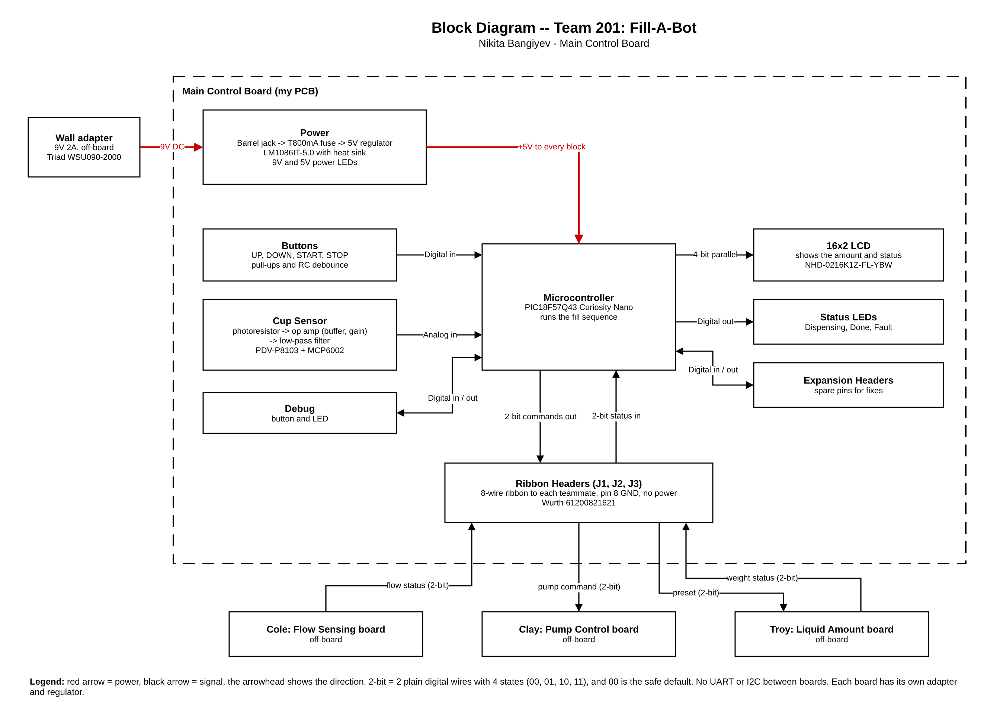

# Block Diagram

Nikita Bangiyev, Team 201, Fill-A-Bot (automatic liquid dispenser)

## Overview

I'm doing the main control board. The user picks one of 4 fill presets with the UP and DOWN buttons and presses START. My board tells Troy's board which preset was picked, tells Clay's board to run the pump, and then watches the flow status from Cole's board and the weight status from Troy's board. When Troy's board says the target is reached, my board stops the pump. If Cole's board says there's no flow, my board stops the pump and flashes the Fault LED. The amount and status show on a 16x2 LCD. My sensor is a photoresistor under the cup spot with an op amp and a low-pass filter, so the pump only starts when a cup is there.

The boards don't use UART, I2C, or SPI. Each signal between two boards is just 2 plain digital wires driven high or low, so it can send 4 states (00, 01, 10, 11). My board has 2 of these outputs (pump command and weight command) and 2 inputs (weight status and flow status).

{ width="100%" }

Figure 1: Main control board block diagram (click to enlarge)

Source files: [nikita-block-diagram-source.zip](nikita-block-diagram-source.zip) (draw.io file and PNG)

## Power

- 9V 2A regulated wall adapter (Triad WSU090-2000) into a barrel jack (Same Sky PJ-102AH)
- T800mA fuse (Littelfuse 0218.800MXP) in a 5x20mm holder right after the jack
- LM1086IT-5.0 linear regulator makes 5V (1.5A max, 4.9 to 5.1V) for the whole board
- The regulator has a heat sink (Same Sky HSE14-384225P) with an insulating pad, because its tab is at 5V
- The Nano gets 5V on VTG with VOFF tied to GND
- D6 lights up when 9V is in, and D5 lights up when 5V is on
- My power budget is 432mA with the 25% margin (see [Power Budget](../05-Power-Budget/Power-Budget.md))

## Pin Assignments

| Pin | Use | Connects to |
|---|---|---|
| RA0 | Digital input | SW1 UP button, next preset (active low, 10k pull-up) |
| RA1 | Digital input | SW2 DOWN button, last preset |
| RA2 | Digital input | SW3 START button, start the fill |
| RA3 | Digital input | SW4 STOP button, cancel |
| RF4 | Digital input | SW5 debug button |
| RA5 | ADC | Cup sensor (op amp and low-pass filter output) |
| RD0 | Digital output | D2 Dispensing LED (active low, 2.2k) |
| RD1 | Digital output | D3 Done LED |
| RD2 | Digital output | D4 Fault LED |
| RF2 | Digital output | D1 debug LED |
| RC0 | Digital output | LCD DB4 |
| RC1 | Digital output | LCD DB5 |
| RC2 | Digital output | LCD DB6 |
| RC3 | Digital output | LCD DB7 |
| RC4 | Digital output | LCD RS |
| RC5 | Digital output | LCD E |
| RC7 / RC6 | Digital inputs | Flow status S1 / S0, from Cole (J1 pins 3 / 4) |
| RD4 / RD3 | Digital outputs | Pump command C1 / C0, to Clay (J2 pins 1 / 2) |
| RF6 / RF5 | Digital outputs | Weight command C1 / C0, to Troy (J3 pins 1 / 2) |
| RE1 / RE0 | Digital inputs | Weight status S1 / S0, from Troy (J3 pins 3 / 4) |

All four inputs from the ribbons (RC7, RC6, RE1, RE0) have a 100k pull-down, so an unplugged cable reads 00.

## Ribbon Connectors

J1 goes to Cole, J2 to Clay, and J3 to Troy. All three use the same layout and follow the class standard (pins 1-5 digital, 6-7 analog, 8 ground). Pins 1-2 are always my outputs, pins 3-4 are always the teammate's outputs coming back to me, and pin 8 is ground.

| Pin | J1 (Cole) | J2 (Clay) | J3 (Troy) |
|---|---|---|---|
| 1 | Not connected | Pump command C1 out (RD4) | Weight command C1 out (RF6) |
| 2 | Not connected | Pump command C0 out (RD3) | Weight command C0 out (RF5) |
| 3 | Flow status S1 in (RC7) | Not connected | Weight status S1 in (RE1) |
| 4 | Flow status S0 in (RC6) | Not connected | Weight status S0 in (RE0) |
| 5-7 | Not connected | Not connected | Not connected |
| 8 | GND | GND | GND |

There's no power pin on the ribbon. Every board has its own adapter and regulator, and pins 1-7 have to go to the microcontroller. All signals are 5V logic.

## Signal Codes

Bit 1 is the first pin of the pair and bit 0 is the second. 00 is the safe default on every signal.

| Signal | Direction | 00 | 01 | 10 | 11 |
|---|---|---|---|---|---|
| Pump command | Me to Clay | Stop | Run | Not used (stop) | Not used (stop) |
| Weight command | Me to Troy | Preset 1 | Preset 2 | Preset 3 | Preset 4 |
| Weight status | Troy to me | Not ready | Below target (filling) | Target reached | Error |
| Flow status | Cole to me | No flow | Flowing | Not used (no flow) | Sensor fault |

The team is still picking the four preset amounts. The weight command can sit at Preset 1 by default because it never turns anything on. Only the pump command does, and its default is Stop.

## Parts

| Part | Manufacturer | Part # |
|---|---|---|
| Curiosity Nano (U1) | Microchip | PIC18F57Q43 (DM164150) |
| 5V regulator (U2) | Texas Instruments | LM1086IT-5.0/NOPB |
| Regulator heat sink | Same Sky | HSE14-384225P |
| 9V wall adapter | Triad Magnetics | WSU090-2000 |
| Barrel jack (J4) | Same Sky | PJ-102AH |
| Fuse (F1) | Littelfuse | 0218.800MXP |
| Photoresistor (LDR1) | Advanced Photonix | PDV-P8103 |
| Op amp (U3) | Microchip | MCP6002-I/P |
| 16x2 LCD (DS1) | Newhaven Display | NHD-0216K1Z-FL-YBW |
| Buttons (SW1-SW5) | Omron | B3F-1000 |
| Ribbon headers (J1-J3) | Wurth Elektronik | 61200821621 |

## Notes

- I switched from a 4-digit 7-segment display to a 16x2 LCD, because the team requirements need words like Ready, Filling, and Finished. The LCD has its own controller, so the HT16K33 driver is gone. It was discontinued anyway.
- The op amp is needed because a photoresistor and resistor alone don't count as an analog sensor. U3A buffers the divider and U3B amplifies it with a gain of -3 around a 2.5V reference. Then R10 and C9 make a low-pass filter (about 16 Hz) before the ADC.
- The team ribbon used to be I2C, and then UART. On Oct 22 we dropped both (the professor suggested it), so now each signal is 2 plain digital wires with 4 states. It's simpler to wire, test with an LED or meter, and debug.
- I switched from the LM7805 to the LM1086 because the LCD backlight needs 4.9 to 5.1V, and a 7805 can be 4.75 to 5.25V.

## References

1. Microchip, PIC18F57Q43 Curiosity Nano Hardware User Guide. [Link](https://ww1.microchip.com/downloads/aemDocuments/documents/MCU08/ProductDocuments/UserGuides/PIC18F57Q43-Curiosity-Nano-HW-UserGuide-DS40002186B.pdf)
2. Microchip, PIC18F27/47/57Q43 data sheet. [Link](https://ww1.microchip.com/downloads/aemDocuments/documents/MCU08/ProductDocuments/DataSheets/PIC18F27-47-57Q43-Microcontroller-Data-Sheet-XLP-DS40002147.pdf)
3. Texas Instruments, LM1086 datasheet. [Link](https://www.ti.com/lit/ds/symlink/lm1086.pdf)
4. Same Sky, HSE14-384225P heat sink datasheet. [Link](https://www.sameskydevices.com/product/resource/hse14-384225p.pdf)
5. Triad Magnetics, WSU090-2000 datasheet. [Link](https://catalog.triadmagnetics.com/Asset/WSU090-2000.pdf)
6. Newhaven Display, NHD-0216K1Z-FL-YBW datasheet. [Link](https://newhavendisplay.com/content/specs/NHD-0216K1Z-FL-YBW.pdf)
7. Microchip, MCP6002 datasheet. [Link](https://ww1.microchip.com/downloads/en/DeviceDoc/MCP6001-1R-1U-2-4-1-MHz-Low-Power-Op-Amp-DS20001733L.pdf)
8. Advanced Photonix, PDV-P8103 datasheet. [Link](https://media.digikey.com/pdf/data%20sheets/photonic%20detetectors%20inc%20pdfs/pdv-p8103.pdf)
9. Same Sky, PJ-102AH datasheet. [Link](https://www.sameskydevices.com/product/resource/pj-102ah.pdf)
10. Omron, B3F tactile switch. [Link](https://components.omron.com/us-en/products/switches/B3F)
11. Wurth Elektronik, WR-BHD box header. [Link](https://www.we-online.com/en/components/products/WTB_WR_BHD_BOX_HEADER_2_54MM_MALE_PCB)
12. EGR 304 Project Description. [Link](https://embedded-systems-design.bitbucket.io/304/course-info/project-description/)
