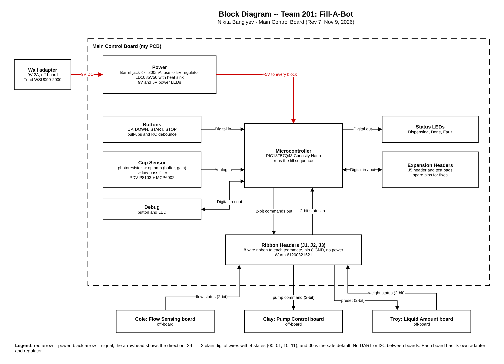

# Block Diagram

Nikita Bangiyev, Team 201, Fill-A-Bot

{ width="100%" }

Figure 1: Main Control Board block diagram (Rev 7)

Source files: [nikita-block-diagram-source.zip](nikita-block-diagram-source.zip) (draw.io file and PNG)

## How It Works

The user presses UP for preset 1 or DOWN for preset 2, then presses START. My board sends the preset to Troy's board and tells Clay's board to run the pump. While it fills, my board watches the weight status from Troy and the flow status from Cole. When Troy's board says the target is reached, my board stops the pump. If Cole's board says there's no flow, it stops the pump and flashes the Fault LED. STOP cancels at any time.

A photoresistor under the cup spot goes through an op amp and a low-pass filter into the ADC, so the pump only starts when there's a cup. Three LEDs show Dispensing, Done, and Fault.

The boards don't use UART, I2C, or SPI. Each signal between boards is 2 plain wires, so it has 4 states (00, 01, 10, 11), and 00 is always the safe one.

## Blocks

| Block | What it does | Signal |
|---|---|---|
| Power | 9V adapter, barrel jack, T800mA fuse, and the LD1085V50 5V regulator on a heat sink. D6 lights up when 9V is in and D5 when 5V is on. | +5V to every block |
| Microcontroller | PIC18F57Q43 Curiosity Nano. Runs the fill. 5V goes to VTG and VOFF is tied to GND. | |
| Buttons | UP, DOWN, START, STOP with pull-ups and RC debounce | Digital in |
| Cup Sensor | Photoresistor, op amp buffer and gain stage, low-pass filter | Analog in |
| Status LEDs | Dispensing, Done, Fault | Digital out |
| Debug | Debug button and LED | Digital in / out |
| Expansion Headers | J5 (8 spare pins) and 14 test pads on the other spare pins | Digital in / out |
| Ribbon Headers | J1 to Cole, J2 to Clay, J3 to Troy | 2-bit out, 2-bit in |

I left the PIC pin numbers off the diagram to keep it simple. They're on my [Component Selection](../02-Component-Selection/Component-Selection.md) and [Schematics](../04-Schematic/schematic.md) pages.

## Ribbon Connectors

All three headers follow the class standard: 8 wires, pin 8 is ground, and no power pin. Pins 1-2 are my outputs and pins 3-4 come back from the teammate. My inputs have 100k pull-downs, so an unplugged cable reads 00.

| Pin | J1 (Cole) | J2 (Clay) | J3 (Troy) |
|---|---|---|---|
| 1-2 | Not used | Pump command out | Preset out |
| 3-4 | Flow status in | Not used | Weight status in |
| 5-7 | Not used | Not used | Not used |
| 8 | GND | GND | GND |

| Signal | 00 | 01 | 10 | 11 |
|---|---|---|---|---|
| Pump command (to Clay) | Stop | Run | Not used (stop) | Not used (stop) |
| Preset (to Troy) | Preset 1 | Preset 2 | Preset 3 | Preset 4 |
| Weight status (from Troy) | Not ready | Below target | Target reached | Error |
| Flow status (from Cole) | No flow | Flowing | Not used (no flow) | Sensor fault |

Right now I only use Preset 1 (UP) and Preset 2 (DOWN). The other two codes are still there in case we add more presets.

## Parts

| Part | Manufacturer | Part # |
|---|---|---|
| Curiosity Nano (U1) | Microchip | PIC18F57Q43 (DM164150) |
| 5V regulator (U2) | STMicroelectronics | LD1085V50 |
| Regulator heat sink | Same Sky | HSE14-384225P |
| 9V wall adapter | Triad Magnetics | WSU090-2000 |
| Barrel jack (J4) | Same Sky | PJ-102AH |
| Fuse (F1) | Littelfuse | 0218.800MXP |
| Photoresistor (LDR1) | Advanced Photonix | PDV-P8103 |
| Op amp (U3) | Microchip | MCP6002-I/P |
| Buttons (SW1-SW5) | Omron | B3F-1000 |
| Ribbon headers (J1-J3) | Wurth Elektronik | 61200821621 |

## Changes

- Rev 7 (Nov 7): I took the 16x2 LCD off the board, so its block is gone. The status shows on the LEDs now.
- Rev 5 (Nov 4): The LM1086 regulator was backordered, so I switched to the LD1085V50. Same pinout and same 4.9 to 5.1V output.
- After the Oct 26 design review I simplified the diagram: no pin numbers, one block per function, red arrows for power, and black arrows for signals.
- On Oct 22 the team dropped I2C and UART between boards (the professor suggested it) and went with 2-wire signals.

## References

1. Microchip, PIC18F57Q43 Curiosity Nano Hardware User Guide. [Link](https://ww1.microchip.com/downloads/aemDocuments/documents/MCU08/ProductDocuments/UserGuides/PIC18F57Q43-Curiosity-Nano-HW-UserGuide-DS40002186B.pdf)
2. Microchip, PIC18F27/47/57Q43 data sheet. [Link](https://ww1.microchip.com/downloads/aemDocuments/documents/MCU08/ProductDocuments/DataSheets/PIC18F27-47-57Q43-Microcontroller-Data-Sheet-XLP-DS40002147.pdf)
3. STMicroelectronics, LD1085 datasheet. [Link](https://www.st.com/resource/en/datasheet/ld1085.pdf)
4. Same Sky, HSE14-384225P heat sink datasheet. [Link](https://www.sameskydevices.com/product/resource/hse14-384225p.pdf)
5. Triad Magnetics, WSU090-2000 datasheet. [Link](https://catalog.triadmagnetics.com/Asset/WSU090-2000.pdf)
6. Microchip, MCP6002 datasheet. [Link](https://ww1.microchip.com/downloads/en/DeviceDoc/MCP6001-1R-1U-2-4-1-MHz-Low-Power-Op-Amp-DS20001733L.pdf)
7. Advanced Photonix, PDV-P8103 datasheet. [Link](https://media.digikey.com/pdf/data%20sheets/photonic%20detetectors%20inc%20pdfs/pdv-p8103.pdf)
8. Same Sky, PJ-102AH datasheet. [Link](https://www.sameskydevices.com/product/resource/pj-102ah.pdf)
9. Omron, B3F tactile switch. [Link](https://components.omron.com/us-en/products/switches/B3F)
10. Wurth Elektronik, WR-BHD box header. [Link](https://www.we-online.com/en/components/products/WTB_WR_BHD_BOX_HEADER_2_54MM_MALE_PCB)
11. EGR 304 Project Description. [Link](https://embedded-systems-design.bitbucket.io/304/course-info/project-description/)
