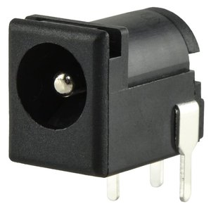
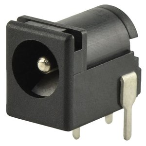
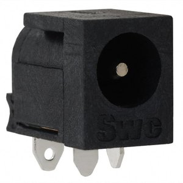
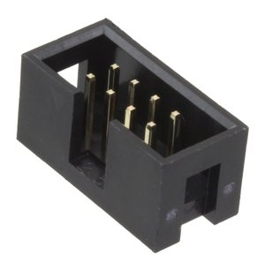
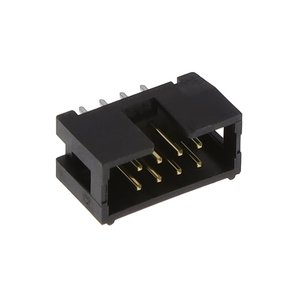
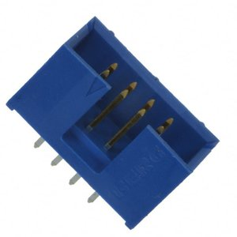

# Component Selection

**My subsystem: Main Control Board.** This is an individual assignment, so this page covers the blocks in my individual block diagram. Clay's pump, Cole's flow sensor, and Troy's load cell are on their own Component Selection pages. **The parts I picked for my board are in bold.**

My board reads the UP, DOWN, START, and STOP buttons, checks that a cup is there, sends and reads simple 2-wire digital signals on the ribbon cables to my teammates' boards, and shows the amount and status on a display. The assignment says not to make tables for the microcontroller, buttons, LEDs, resistors, or capacitors, so those don't have tables. Prices are from DigiKey for one part (October 2026).

## 1. Power Source

| Solution | Pros | Cons |
|---|---|---|
| { width="110" } Option 1. Triad Magnetics WSU090-1300 9V 1.3A wall adapter $8.65/each [DigiKey](https://www.digikey.com/en/products/detail/triad-magnetics/WSU090-1300/3094977) / [Datasheet](https://catalog.triadmagnetics.com/Asset/WSU090-1300.pdf) | - Most inexpensive adapter - In stock at DigiKey - Long 6 ft cord | - Fine for my real load, but less than the regulator's 1.5A rating - Output can be off by 5% - Big body blocks the next outlet |
| { width="110" } Option 2. MEAN WELL GST18U09-P1J 9V 2A wall adapter $14.10/each [DigiKey](https://www.digikey.com/en/products/detail/mean-well-usa-inc/GST18U09-P1J/7703633) / [Datasheet](https://www.meanwellusa.com/upload/pdf/GST18U/GST18U-spec.pdf) | - 2A is more than enough - Lowest ripple of the three - Wide temperature range | - Most expensive adapter - Out of stock at DigiKey - Short 1.2 m cord |
| { width="110" } **Option 3.** **Triad Magnetics WSU090-2000** **9V 2A wall adapter** **$12.43/each** [DigiKey](https://www.digikey.com/en/products/detail/triad-magnetics/WSU090-2000/3094951) / [Datasheet](https://catalog.triadmagnetics.com/Asset/WSU090-2000.pdf) | - 2A covers the regulator's full 1.5A - In stock at DigiKey - Long 6 ft cord | - Costs more than the 1.3A one - Output can be off by 5% - Only rated up to 40 C |

**Choice:** **Option 3: Triad WSU090-2000 (Main Control Board)**

**Rationale:** The LM1086 regulator is rated for up to 1.5A, but that's only how much it can supply. It's not what my board actually uses. My board uses 345.8mA. With the 25% safety margin that's 432.3mA. The regulator uses about 10mA itself and the 9V power LED uses about 2mA, so the adapter has to give about 444mA. All three adapters can do that. The class power budget template also checks the adapter against the regulator's full 1.5A rating, so I picked a 2A adapter to pass that check too (2000mA - 1500mA = 500mA left). The Triad is in stock and costs less than the MEAN WELL, and it has the 5.5 x 2.1 mm center-positive plug. The full numbers are on my [Power Budget](../05-Power-Budget/Power-Budget.md) page.

## 2. Barrel Jack

| Solution | Pros | Cons |
|---|---|---|
| { width="110" } **Option 1.** **Same Sky PJ-102AH** **DC barrel jack, 2.0 mm pin, through hole** **$0.77/each** [DigiKey](https://www.digikey.com/en/products/detail/same-sky-formerly-cui-devices/PJ-102AH/408448) / [Datasheet](https://www.sameskydevices.com/product/resource/pj-102ah.pdf) | - Rated 5A, way more than my board needs - Inexpensive - Lots in stock at DigiKey | - 2.0 mm pin, so I have to check how tight the 2.1 mm plug fits - Right-angle part has to sit at the board edge - Costs a little more than the PJ-102A |
| { width="110" } Option 2. Same Sky PJ-102A DC barrel jack, 2.0 mm pin, through hole $0.70/each [DigiKey](https://www.digikey.com/en/products/detail/same-sky-formerly-cui-devices/PJ-102A/275425) / [Datasheet](https://www.sameskydevices.com/product/resource/pj-102a.pdf) | - Most inexpensive jack - Same size and pins as the PJ-102AH - Lots in stock at DigiKey | - Only rated 2.5A - Same 2.0 mm pin fit question - Less extra current room than the AH version |
| { width="110" } Option 3. Switchcraft RAPC722X DC barrel jack, through hole $2.23/each [DigiKey](https://www.digikey.com/en/products/detail/switchcraft-inc/RAPC722X/804747) / [Datasheet](https://www.switchcraft.com/assets/1/24/rapc722x_cd.pdf) | - Rated 5A - Very common jack - Lots in stock at DigiKey | - Most expensive jack, about 3x the others - Different footprint than the Same Sky jacks - No real advantage for my 0.44A load |

**Choice:** **Option 1: Same Sky PJ-102AH (Main Control Board)**

**Rationale:** The course requires a barrel jack for the 9V adapter. The PJ-102AH is rated 5A, so it has a lot of room over my 0.44A. It's inexpensive and it's already in my block diagram. DigiKey lists its mating plug as 5.5 x 2.0 mm, and my adapter plug is 5.5 x 2.1 mm, so I'll check the fit when the parts come in.

## 3. 5V Linear Regulator

| Solution | Pros | Cons |
|---|---|---|
| { width="110" } Option 1. Texas Instruments LM7805CT/NOPB 5V 1.5A, TO-220 $1.86/each [DigiKey](https://www.digikey.com/en/products/detail/texas-instruments/LM7805CT-NOPB/3901929) / [Datasheet](https://www.ti.com/lit/ds/symlink/lm340.pdf) | - Really common part - Built-in thermal protection - Easy to solder | - Output can be 4.75 to 5.25V - About 2V dropout - Out of stock |
| { width="110" } Option 2. STMicroelectronics L7805CV 5V 1.5A, TO-220 $1.08/each [DigiKey](https://www.digikey.com/en/products/detail/stmicroelectronics/L7805CV/585964) / [Datasheet](https://www.st.com/resource/en/datasheet/l78.pdf) | - Most inexpensive regulator - Lots in stock - Standard 7805 pinout | - Output can be 4.75 to 5.25V - About 2V dropout - Gets just as hot as the others |
| { width="110" } **Option 3.** **Texas Instruments LM1086IT-5.0/NOPB** **5V 1.5A low dropout, TO-220** **$2.58/each** [DigiKey](https://www.digikey.com/en/products/detail/texas-instruments/LM1086IT-5-0-NOPB/363580) / [Datasheet](https://www.ti.com/lit/ds/symlink/lm1086.pdf) | - Output stays 4.9 to 5.1V - Only 1.5V max dropout - In stock at DigiKey | - Needs an output cap with some ESR to stay stable (TI recommends 10uF tantalum or 50uF aluminum) - Different pinout than a 7805 - Costs a little more |

**Choice:** **Option 3: TI LM1086IT-5.0/NOPB (Main Control Board)**

**Rationale:** My LCD backlight needs 4.9 to 5.1V, and the LM1086 is the only one here that stays in that range. The 7805s can go up to 5.25V. I'll put a 10uF tantalum capacitor on the output, which is one of the two options TI recommends for stability.

## 4. Regulator Heat Sink

| Solution | Pros | Cons |
|---|---|---|
| { width="110" } **Option 1.** **Same Sky HSE14-384225P** **TO-220 heat sink** **$2.24/each** [DigiKey](https://www.digikey.com/en/products/detail/same-sky-formerly-cui-devices/HSE14-384225P/26460932) / [Datasheet](https://www.sameskydevices.com/product/resource/hse14-384225p.pdf) | - 10 C/W at 1W in still air - Small 41.6 x 25 mm footprint - In stock at DigiKey | - 38.1 mm tall - Needs an insulating pad since the LM1086 tab is at 5V - Not as strong as the Boyd parts |
| { width="110" } Option 2. Boyd 529802B02500G TO-220 heat sink $2.02/each [DigiKey](https://www.digikey.com/en/products/detail/boyd-laconia-llc/529802B02500G/1216357) / [Catalog](https://info.boydcorp.com/hubfs/Thermal/Air-Cooling/Boyd-Board-Level-Heatsinks-Catalog.pdf) | - Lower thermal resistance (3.7 C/W at a 75 C rise) - Most inexpensive heat sink - Same size footprint | - Out of stock at DigiKey - Also 38.1 mm tall - More cooling than I need |
| { width="110" } Option 3. Boyd 530002B02500G TO-220 heat sink $4.03/each [DigiKey](https://www.digikey.com/en/products/detail/boyd-laconia-llc/530002B02500G/1216384) / [Catalog](https://info.boydcorp.com/hubfs/Thermal/Air-Cooling/Boyd-Board-Level-Heatsinks-Catalog.pdf) | - Lowest thermal resistance (2.6 C/W at a 75 C rise) - In stock at DigiKey - Same size footprint | - 63.5 mm tall, hard to fit in a box - Most expensive heat sink - Way more cooling than I need |

**Choice:** **Option 1: Same Sky HSE14-384225P (Main Control Board)**

**Rationale:** It's in stock, small enough for my board, and enough to keep the regulator cool. The Boyd 529802B02500G is out of stock, and the taller Boyd is way bigger than I need. The Boyd numbers are at a 75 C rise, so they aren't measured the same way as the Same Sky number.

Here is how I checked the regulator temperature:

| What | Value | Where it comes from |
|---|---|---|
| Highest adapter voltage | 9.45V | 9V + 5% (Triad datasheet) |
| Lowest regulator output | 4.9V | LM1086 datasheet |
| Output current | 432.3mA | My power budget, with the 25% margin |
| Regulator's own current | 10mA max | LM1086 datasheet |
| Heat = (9.45 - 4.9) x 0.4323 + 9.45 x 0.010 | 2.06W | Calculated |
| Junction to case | 4.0 C/W | LM1086 datasheet (TO-220, output section) |
| Insulating pad | 1.0 C/W | My guess (a Bergquist SP900S pad is listed at 0.61 C/W) |
| Heat sink | 10 C/W | HSE14-384225P datasheet (still air, 1W) |
| Air inside the enclosure | 40 C | My assumption |
| Junction temp = 40 + 2.06 x (4.0 + 1.0 + 10) | about 71 C | Calculated |
| Limit | 125 C | LM1086 datasheet (control section) |

So it should stay well under the limit. The heat sink datasheet shows 19.2 C of rise at 2W (9.6 C/W), so using 10 C/W is a little on the safe side. I'll still check the real temperature once the board is built.

## 5. Cup Sensor (Analog)

| Solution | Pros | Cons |
|---|---|---|
| { width="110" } **Option 1.** **Advanced Photonix PDV-P8103** **Photoresistor (LDR)** **$0.72/each** [DigiKey](https://www.digikey.com/en/products/detail/advanced-photonix/PDV-P8103/480610) / [Datasheet](https://media.digikey.com/pdf/data%20sheets/photonic%20detetectors%20inc%20pdfs/pdv-p8103.pdf) | - Big change between light and shadow - Sees normal room light - Used it in my photoresistor lab | - Slow (about 60ms) - Room light changes the reading - Each one is a little different |
| { width="110" } Option 2. Vishay TEPT4400 Phototransistor $0.50/each [DigiKey](https://www.digikey.com/en/products/detail/vishay-semiconductor-opto-division/TEPT4400/1681191) / [Datasheet](https://www.vishay.com/docs/81341/tept4400.pdf) | - Most inexpensive sensor - Reacts quickly to changes - Responds like the human eye | - Big part-to-part difference - Can max out in bright light - Narrow viewing angle |
| { width="110" } Option 3. Vishay BPW34 Photodiode $1.37/each [DigiKey](https://www.digikey.com/en/products/detail/vishay-semiconductor-opto-division/BPW34/1681149) / [Datasheet](https://www.vishay.com/docs/81521/bpw34.pdf) | - Output is very linear with light - Large sensing area - Reacts very quickly | - Needs a different amp circuit - Also picks up infrared - Really small currents |

**Choice:** **Option 1: Advanced Photonix PDV-P8103 (Main Control Board)**

**Rationale:** It's simple, inexpensive, and I already know how it works from lab. It sits under the cup spot with a 10k resistor, and a cup's shadow drops the voltage. A divider alone doesn't count as an analog sensor for this class, so it goes through the op amp below before the ADC. I'll still need to test it with our real cups, since a clear cup may not make much of a shadow.

## 6. Op Amp

| Solution | Pros | Cons |
|---|---|---|
| { width="110" } **Option 1.** **Microchip MCP6002-I/P** **Dual op amp, 8-pin DIP** **$0.45/each** [DigiKey](https://www.digikey.com/en/products/detail/microchip-technology/MCP6002-I-P/500875) / [Datasheet](https://ww1.microchip.com/downloads/en/DeviceDoc/MCP6001-1R-1U-2-4-1-MHz-Low-Power-Op-Amp-DS20001733L.pdf) | - Rail-to-rail on 5V - Two op amps in one chip - Very low current | - Higher offset voltage - Only 1MHz bandwidth - Doesn't quite reach the rails |
| { width="110" } Option 2. Texas Instruments TLV2372IP Dual op amp, 8-pin DIP $2.38/each [DigiKey](https://www.digikey.com/en/products/detail/texas-instruments/TLV2372IP/413506) / [Datasheet](https://www.ti.com/lit/ds/symlink/tlv2372.pdf) | - Rail-to-rail input and output - Wide supply range - 3MHz bandwidth | - About 5x the price - Uses more current - Speed isn't needed |
| { width="110" } Option 3. Texas Instruments OPA2340UA Dual op amp, SOIC-8 $4.63/each [DigiKey](https://www.digikey.com/en/products/detail/texas-instruments/OPA2340UA-2K5/301193) / [Datasheet](https://www.ti.com/lit/ds/symlink/opa2340.pdf) | - Lowest offset voltage - 5.5MHz bandwidth - Rail-to-rail on 5V | - Most expensive op amp here - Surface mount is harder to solder - Uses the most current |

**Choice:** **Option 1: Microchip MCP6002-I/P (Main Control Board)**

**Rationale:** A cup sensor is slow, so I don't need a fast op amp. The MCP6002 is inexpensive, comes in a DIP, and has two op amps. One buffers the LDR, and the other amplifies it with a gain of -3 around a 2.5V reference (Rin 10k, Rf 30k). I'll set the cup threshold in code after testing.

## 7. Display

| Solution | Pros | Cons |
|---|---|---|
| { width="110" } Option 1. Lucky Light KW4-56NCUYA-P (Adafruit 811) 4-digit 7-segment display $3.95/each [DigiKey](https://www.digikey.com/en/products/detail/adafruit-industries-llc/811/5774235) / [Datasheet](https://cdn-shop.adafruit.com/datasheets/811datasheet.pdf) | - Big, easy to read digits - Bright in any lighting - Inexpensive for 4 digits | - Can't show words like Ready or Filling - Can't show units - Needs a driver chip |
| { width="110" } Option 2. Kingbright PDC54-11SURKWA 2-character 14-segment display $5.60/each (need 4) [DigiKey](https://www.digikey.com/en/products/detail/kingbright/PDC54-11SURKWA/16602198) / [Datasheet](https://www.kingbrightusa.com/images/catalog/SPEC/PDC54-11SURKWA.pdf) | - Can show letters - Bright, high contrast - Big 0.53 in characters | - 4 of them are too wide for my board - Needs a driver chip - Only 8 characters |
| { width="110" } **Option 3.** **Newhaven Display NHD-0216K1Z-FL-YBW** **16x2 character LCD** **$7.83/each** [DigiKey](https://www.digikey.com/en/products/detail/newhaven-display-intl/NHD-0216K1Z-FL-YBW/1701171) / [Datasheet](https://newhavendisplay.com/content/specs/NHD-0216K1Z-FL-YBW.pdf) | - Shows the amount, units, and status at once - Built-in controller, no driver chip - Backlight makes it easy to read | - Backlight uses up to 156mA - Needs a contrast pot - Uses 6 pins |

**Choice:** **Option 3: Newhaven NHD-0216K1Z-FL-YBW (Main Control Board)**

**Rationale:** Our team requirements say the display has to show the amount, the units, and words like Ready, Filling, and Finished. The LCD is the only option that can do all of that at once. It wires straight to the Nano in 4-bit mode (RC0-RC5), so I don't need a driver chip or a serial backpack board.

## 8. Ribbon Cable Header

| Solution | Pros | Cons |
|---|---|---|
| { width="110" } **Option 1.** **Wurth Elektronik 61200821621** **2x4 box header, 2.54 mm** **$1.03/each** [DigiKey](https://www.digikey.com/en/products/detail/w%C3%BCrth-elektronik/61200821621/4846916) / [Datasheet](https://www.we-online.com/components/products/datasheet/61200821621.pdf) | - Most inexpensive header - Keying slot so the ribbon only goes in one way - Gold-plated contacts | - No latch to lock the cable in - Shorter shroud than the 3M part - I need three of them (J1-J3) |
| { width="110" } Option 2. 3M N2508-6002-RB 2x4 box header, 2.54 mm $2.31/each [DigiKey](https://www.digikey.com/en/products/detail/3m/N2508-6002-RB/2609703) / [Datasheet](https://multimedia.3m.com/mws/media/330367O/3m-four-wall-header-2500-series-ts-0770.pdf) | - Keyed so the cable only fits one way - Rated 5A per contact - Wide -55 to 105 C range | - Most expensive header, about 2x the others - Fewer in stock - No latch to lock the cable in |
| { width="110" } Option 3. Amphenol ICC 75869-132LF 2x4 box header, 2.54 mm $1.10/each [DigiKey](https://www.digikey.com/en/products/detail/amphenol-icc-fci/75869-132LF/1524248) / [Datasheet](https://www.waldom.com/upload/parts/datasheets/mf-fci/fci-75869-132lf.pdf) | - Almost as inexpensive as the Wurth - Keyed so the cable only fits one way - Lots in stock at DigiKey | - No latch to lock the cable in - Costs a little more than the Wurth - Datasheet link is from a distributor, not Amphenol |

**Choice:** **Option 1: Wurth Elektronik 61200821621 (Main Control Board)**

**Rationale:** The class uses an 8-wire ribbon cable with a 2x4 connector between boards, and I need three (J1 to Cole, J2 to Clay, J3 to Troy). The Wurth is the least expensive, it's keyed so the cable can't go in backwards, and it's the part already in my block diagram.

## Pin Assignments

This is how I'll set up each pin in MCC (Pin Grid View). "Start high" means the pin's LAT bit is set to 1 at power-up. None of the pins use the internal weak pull-ups, because every input already has an outside pull-up or pull-down on my board.

| Pin | Subsystem | MCC setting | Connects to |
|---|---|---|---|
| RA0 | Buttons | Digital input | SW1 UP button (next preset), 10k pull-up, active low |
| RA1 | Buttons | Digital input | SW2 DOWN button (last preset), 10k pull-up, active low |
| RA2 | Buttons | Digital input | SW3 START button, 10k pull-up, active low |
| RA3 | Buttons | Digital input | SW4 STOP button (cancel), 10k pull-up, active low |
| RF4 | Debug | Digital input | SW5 debug button, 10k pull-up, active low |
| RA5 | Cup sensor | Analog input (ADC channel ANA5) | Op amp and low-pass filter output |
| RD0 | Status LEDs | Digital output, start high | D2 Dispensing LED (yellow), 2.2k, active low |
| RD1 | Status LEDs | Digital output, start high | D3 Done LED (green), 2.2k, active low |
| RD2 | Status LEDs | Digital output, start high | D4 Fault LED (red), 2.2k, active low |
| RF2 | Debug | Digital output, start high | D1 debug LED (red), 2.2k, active low |
| RC0 | LCD | Digital output, start low | LCD DB4 |
| RC1 | LCD | Digital output, start low | LCD DB5 |
| RC2 | LCD | Digital output, start low | LCD DB6 |
| RC3 | LCD | Digital output, start low | LCD DB7 |
| RC4 | LCD | Digital output, start low | LCD RS |
| RC5 | LCD | Digital output, start low | LCD E (100k pull-down R24) |
| RC7 | Flow status from Cole | Digital input | J1 pin 3 (S1), 100k pull-down |
| RC6 | Flow status from Cole | Digital input | J1 pin 4 (S0), 100k pull-down |
| RD4 | Pump command to Clay | Digital output, start low | J2 pin 1 (C1) |
| RD3 | Pump command to Clay | Digital output, start low | J2 pin 2 (C0) |
| RF6 | Weight command to Troy | Digital output, start low | J3 pin 1 (C1) |
| RF5 | Weight command to Troy | Digital output, start low | J3 pin 2 (C0) |
| RE1 | Weight status from Troy | Digital input | J3 pin 3 (S1), 100k pull-down |
| RE0 | Weight status from Troy | Digital input | J3 pin 4 (S0), 100k pull-down |
| VTG | Power | | 5V from the LM1086 (VOFF tied to GND) |
| GND | Ground | | Board ground and J1-J3 pin 8 |

The ribbon signals don't use UART, I2C, or SPI. Each one is 2 plain digital pins, so it has 4 states (00, 01, 10, 11), and 00 is the safe default. The ribbon outputs start low so the pump command is 00 (stop) at power-up, and the 100k pull-downs make an unplugged cable read 00. The codes for each signal are on my [Block Diagram](../01-Block-Diagram/Block-Diagram.md) page. Ribbon pins 5-7 aren't connected on my board, and there's no power on the ribbon since every board has its own regulator. The spare Nano pins go to the J5 and J6 extra headers.

## Power Budget

My [Power Budget](../05-Power-Budget/Power-Budget.md) is on its own page. The assignment says it's optional for the first submission, but I already finished it.

## References

1. Triad Magnetics WSU090-2000: [DigiKey](https://www.digikey.com/en/products/detail/triad-magnetics/WSU090-2000/3094951), [datasheet](https://catalog.triadmagnetics.com/Asset/WSU090-2000.pdf)
2. Same Sky PJ-102AH: [DigiKey](https://www.digikey.com/en/products/detail/same-sky-formerly-cui-devices/PJ-102AH/408448), [datasheet](https://www.sameskydevices.com/product/resource/pj-102ah.pdf)
3. TI LM1086IT-5.0/NOPB: [DigiKey](https://www.digikey.com/en/products/detail/texas-instruments/LM1086IT-5-0-NOPB/363580), [datasheet](https://www.ti.com/lit/ds/symlink/lm1086.pdf)
4. Same Sky HSE14-384225P: [DigiKey](https://www.digikey.com/en/products/detail/same-sky-formerly-cui-devices/HSE14-384225P/26460932), [datasheet](https://www.sameskydevices.com/product/resource/hse14-384225p.pdf)
5. Advanced Photonix PDV-P8103: [DigiKey](https://www.digikey.com/en/products/detail/advanced-photonix/PDV-P8103/480610), [datasheet](https://media.digikey.com/pdf/data%20sheets/photonic%20detetectors%20inc%20pdfs/pdv-p8103.pdf)
6. Microchip MCP6002-I/P: [DigiKey](https://www.digikey.com/en/products/detail/microchip-technology/MCP6002-I-P/500875), [datasheet](https://ww1.microchip.com/downloads/en/DeviceDoc/MCP6001-1R-1U-2-4-1-MHz-Low-Power-Op-Amp-DS20001733L.pdf)
7. Newhaven NHD-0216K1Z-FL-YBW: [DigiKey](https://www.digikey.com/en/products/detail/newhaven-display-intl/NHD-0216K1Z-FL-YBW/1701171), [datasheet](https://newhavendisplay.com/content/specs/NHD-0216K1Z-FL-YBW.pdf)
8. Wurth Elektronik 61200821621: [DigiKey](https://www.digikey.com/en/products/detail/w%C3%BCrth-elektronik/61200821621/4846916), [datasheet](https://www.we-online.com/components/products/datasheet/61200821621.pdf)
9. Microchip PIC18F57Q43 Curiosity Nano: [user guide](https://ww1.microchip.com/downloads/aemDocuments/documents/MCU08/ProductDocuments/UserGuides/PIC18F57Q43-Curiosity-Nano-HW-UserGuide-DS40002186B.pdf)

Part photos are from DigiKey and may not show the exact part.
