# Component Selection

Nikita Bangiyev, Team 201, Fill-A-Bot (automatic liquid dispenser). Updated October 16, 2026.

**All selections on this page are for my individual subsystem, the Main Control Board.**

My board reads the UP, DOWN, START, and STOP buttons. It checks that a cup is in place, hosts the team I2C bus, and shows the amount and status on a display. Cole (flow sensing), Clay (pump control), and Troy (load cell) pick the parts for their own boards, so their parts and power are on their own datasheets.

## Summary of My Choices

| Block | Choice | Unit price |
|---|---|---|
| **9V power source** | Triad Magnetics WSU090-2000, 9V 2A wall adapter | $12.43 |
| **5V linear regulator** | Texas Instruments LM1086IT-5.0/NOPB | $2.58 |
| **Regulator heat sink** | Same Sky HSE14-384225P | $2.24 |
| **Cup sensor** | Advanced Photonix PDV-P8103 photoresistor | $0.72 |
| **Signal conditioning op amp** | Microchip MCP6002-I/P | $0.45 |
| **Display** | Newhaven Display NHD-0216K1Z-FL-YBW 16x2 LCD | $7.83 |
| **Display interface** | My custom direct wiring, no extra IC | $0.00 |
| | **Total for these parts** | **$26.25** |

Prices are DigiKey prices in USD for one part, checked on October 16, 2026. They do not include shipping, tax, or tariffs. The assigned Curiosity Nano is not in this list. Photos are DigiKey supplier pictures and may not show the exact part (see [Image Credits](#image-credits)).

## Design Requirements

- Team requirement 2.1: the display must show the amount, the units, and status words like Ready, Filling, and Finished.
- Team requirements 3.3 and 4.2: the display must be easy to read and high contrast from the normal operating position.
- Team requirements 1.5 and 3.4: the user can stop a fill at any time with the STOP button.
- Team requirement 6.7: every part has to run inside its rated voltage and current.
- Course rules: 9V barrel jack input, a 5V linear regulator, and the PIC18F57Q43 Curiosity Nano on every board. No daughter boards or breakout boards, no QFN or BGA parts, PCB no bigger than 100 x 100 mm, and $60 per team member.
- Course rule for the analog sensor: it needs a real active amplifier or filter. A sensor and a resistor divider by itself does not count.

The cup sensor only checks that a cup is there. It does not measure how much liquid goes in. The +/-1% fill accuracy (requirement 1.3) depends on Cole's flow sensor, Troy's load cell, and Clay's pump shutoff.

## 1. Power Source (9V Wall Adapter)

All three options are regulated 9V wall adapters with a center-positive 5.5 x 2.1 mm plug. My board still needs its own 5V linear regulator, as the course requires.

| Solution | Pros | Cons |
|---|---|---|
| 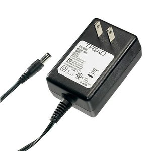{ width="120" }<br>Option 1.<br>9V 1.3A wall adapter<br>Manufacturer: Triad Magnetics<br>Part #: WSU090-1300<br>$8.65/each<br>[DigiKey product page](https://www.digikey.com/en/products/detail/triad-magnetics/WSU090-1300/3094977)<br>[WSU090-1300 datasheet](https://catalog.triadmagnetics.com/Asset/WSU090-1300.pdf) | - Most inexpensive adapter here<br>- 1,099 in stock at DigiKey<br>- 6 ft cord reaches a bench outlet | - 1.3A is less than the regulator's 1.5A rating, so the class template's source check comes out to -200mA<br>- Output can be off by +/-5%<br>- The wall body can block the next outlet |
| 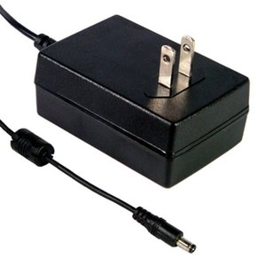{ width="120" }<br>Option 2.<br>9V 2A wall adapter<br>Manufacturer: MEAN WELL<br>Part #: GST18U09-P1J<br>$14.10/each<br>[DigiKey product page](https://www.digikey.com/en/products/detail/mean-well-usa-inc/GST18U09-P1J/7703633)<br>[GST18U datasheet](https://www.meanwellusa.com/upload/pdf/GST18U/GST18U-spec.pdf) | - 2A covers the full 1.5A regulator rating<br>- Lowest ripple here, 80mV peak-to-peak max<br>- Rated from -30 to 70 C | - Most expensive adapter here<br>- DigiKey showed no stock on October 16<br>- 1.2 m cord is the shortest |
| { width="120" }<br>**Option 3.**<br>**9V 2A wall adapter**<br>Manufacturer: Triad Magnetics<br>Part #: WSU090-2000<br>$12.43/each<br>[DigiKey product page](https://www.digikey.com/en/products/detail/triad-magnetics/WSU090-2000/3094951)<br>[WSU090-2000 datasheet](https://catalog.triadmagnetics.com/Asset/WSU090-2000.pdf) | - 2A covers the full 1.5A regulator rating with 500mA left over<br>- 115 in stock at DigiKey<br>- 6 ft, 20 AWG cord | - Costs $3.78 more than the 1.3A model<br>- Ripple can be up to 150mV peak-to-peak<br>- Only rated 0 to 40 C at full load |

**Choice:** Option 3: Triad Magnetics WSU090-2000

**Rationale:** The class power budget template subtracts the full regulator rating (1,500mA) from the power source. The 2A adapter passes that check with 500mA left. My real board input is about 438mA after the 25% margin, so it has a lot of headroom. It is in stock and has the plug and polarity I need. The MEAN WELL has lower ripple, but it costs more and was out of stock. The LM1086 regulator rejects the 150mV ripple, so the ripple does not reach my 5V rail in any meaningful way. My block diagram used a generic "9V 3A" adapter before. I replaced it with a real part number. Any regulated 9V adapter with at least 1.5A and a center-positive 5.5 x 2.1 mm plug would also work.

**Plug fit:** The Triad plug is 5.5 mm outside x 2.1 mm inside x 11 mm long, center positive. My Same Sky PJ-102AH jack has a 2.0 mm center pin and a 9.5 mm insertion depth. DigiKey lists the jack's mating size as 5.5 x 2.0 mm. The 2.1 mm hole slides over the 2.0 mm pin, which is the normal pairing for this plug size, but there is 0.1 mm of clearance. About 1.5 mm of the plug's outer sleeve (the negative side) stays outside the jack. I will check that the plug seats firmly and does not cut out when it is wiggled. If it does, I will change to a jack with a 2.1 mm pin.

## 2. 5V Linear Regulator

| Solution | Pros | Cons |
|---|---|---|
| 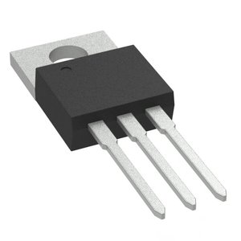{ width="120" }<br>Option 1.<br>5V 1.5A linear regulator, TO-220<br>Manufacturer: Texas Instruments<br>Part #: LM7805CT/NOPB<br>$1.86/each<br>[DigiKey product page](https://www.digikey.com/en/products/detail/texas-instruments/LM7805CT-NOPB/3901929)<br>[LM340/LM7805 datasheet](https://www.ti.com/lit/ds/symlink/lm340.pdf) | - Classic part used in a lot of class examples<br>- Has thermal and short-circuit protection<br>- TO-220 bolts to a heat sink | - Output can be 4.75 to 5.25V, which is wider than the LCD backlight allows (4.9 to 5.1V)<br>- About 2V dropout at 1A<br>- DigiKey showed no stock on October 16 |
| 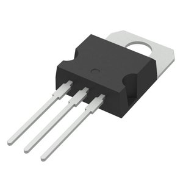{ width="120" }<br>Option 2.<br>5V 1.5A linear regulator, TO-220<br>Manufacturer: STMicroelectronics<br>Part #: L7805CV<br>$1.08/each<br>[DigiKey product page](https://www.digikey.com/en/products/detail/stmicroelectronics/L7805CV/585964)<br>[L78 datasheet](https://www.st.com/resource/en/datasheet/l78.pdf) | - Most inexpensive regulator here<br>- 86,866 in stock at DigiKey<br>- Standard 7805 pinout (IN, GND, OUT) | - Output can also be 4.75 to 5.25V<br>- About 2V dropout at 1A<br>- Makes the same heat as the others, since all of them drop 9V to 5V |
| { width="120" }<br>**Option 3.**<br>**5V 1.5A low-dropout linear regulator, TO-220**<br>Manufacturer: Texas Instruments<br>Part #: LM1086IT-5.0/NOPB<br>$2.58/each<br>[DigiKey product page](https://www.digikey.com/en/products/detail/texas-instruments/LM1086IT-5-0-NOPB/363580)<br>[LM1086 datasheet](https://www.ti.com/lit/ds/symlink/lm1086.pdf) | - Output stays 4.90 to 5.10V over line, load, and temperature<br>- 1.5A rating and 1.5V max dropout<br>- 784 in stock at DigiKey | - Needs a 10uF tantalum (or 50uF aluminum) output capacitor to stay stable<br>- Pinout is not the 7805 pinout, and the tab is VOUT<br>- Costs more than the 7805 options |

**Choice:** Option 3: Texas Instruments LM1086IT-5.0/NOPB

**Rationale:** The LCD backlight is only rated for 4.9 to 5.1V. The LM1086-5.0 is the only option here that guarantees that range. The 7805 parts can be anywhere from 4.75 to 5.25V, so they could run the backlight out of spec, which breaks team requirement 6.7. The 1.5V max dropout leaves a lot of room from a 9V adapter. All three parts make about the same heat because they all drop 9V down to 5V, so a lower dropout does not mean less heat here.

**How I will use it:** A 10uF capacitor goes on the input and a 10uF solid tantalum capacitor goes on the output, both close to the pins (TI datasheet section 7.4.2). Each IC also gets a 100nF ceramic bypass capacitor. Looking at the front with the leads down, the pins are 1 GND, 2 VOUT, 3 VIN, and the tab is VOUT. My footprint cannot use a 7805 pinout.

**Dropout check:** The lowest adapter output is 9V - 5% = 8.55V. Taking off half the ripple (0.075V) and about 0.07V for the cord and jack leaves about 8.4V. The LM1086 needs at most 5.1V + 1.5V = 6.6V, so I have about 1.8V of headroom. The heat numbers are on the [Power Budget](../05-Power-Budget/Power-Budget.md) page.

## 3. Regulator Heat Sink

My worst-case regulator heat is about 2.04W (see the Power Budget). TI lists 23 C/W junction-to-ambient for this package, but that number is measured on a standard JEDEC test board, not my PCB. I do not want to rely on it, so I am adding a heat sink. A heat sink is passive and does not add any current to my budget.

| Solution | Pros | Cons |
|---|---|---|
| 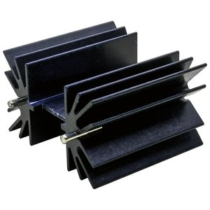{ width="120" }<br>**Option 1.**<br>**TO-220 board-mount heat sink**<br>Manufacturer: Same Sky<br>Part #: HSE14-384225P<br>$2.24/each<br>[DigiKey product page](https://www.digikey.com/en/products/detail/same-sky-formerly-cui-devices/HSE14-384225P/26460932)<br>[HSE14-384225P datasheet](https://www.sameskydevices.com/product/resource/hse14-384225p.pdf) | - 10 C/W at 1W in still air (9.6 C/W at 2W), enough for 2W<br>- 41.6 x 25 mm footprint fits on my 100 x 100 mm board<br>- 551 in stock, with solder pins and a bolt to hold it | - 38.1 mm tall, so the enclosure needs room above it<br>- Needs an insulating pad and shoulder washer because the regulator tab is at 5V<br>- Rated in open air, so a closed box makes it run hotter |
| 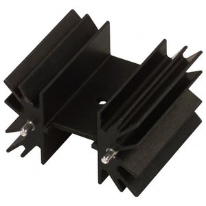{ width="120" }<br>Option 2.<br>TO-220 board-mount heat sink<br>Manufacturer: Boyd<br>Part #: 529802B02500G<br>$2.02/each<br>[DigiKey product page](https://www.digikey.com/en/products/detail/boyd-laconia-llc/529802B02500G/1216357)<br>[Boyd heat sink catalog](https://info.boydcorp.com/hubfs/Thermal/Air-Cooling/Boyd-Board-Level-Heatsinks-Catalog.pdf) | - Lower thermal resistance, 3.7 C/W at a 75 C rise<br>- Most inexpensive heat sink here<br>- Same 41.9 x 25.4 mm footprint and solder pins | - 0 in stock; DigiKey expects more on January 8, 2027, after our build<br>- Also 38.1 mm tall<br>- More cooling than a 2W load needs |
| 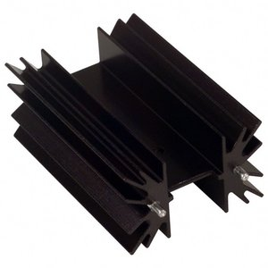{ width="120" }<br>Option 3.<br>TO-220 board-mount heat sink<br>Manufacturer: Boyd<br>Part #: 530002B02500G<br>$4.03/each<br>[DigiKey product page](https://www.digikey.com/en/products/detail/boyd-laconia-llc/530002B02500G/1216384)<br>[Boyd heat sink catalog](https://info.boydcorp.com/hubfs/Thermal/Air-Cooling/Boyd-Board-Level-Heatsinks-Catalog.pdf) | - Lowest thermal resistance, 2.6 C/W at a 75 C rise<br>- 11,201 in stock at DigiKey<br>- Same footprint as the shorter Boyd part | - 63.5 mm tall, hard to fit in a small enclosure<br>- Most expensive heat sink here<br>- Far more cooling than I need |

**Choice:** Option 1: Same Sky HSE14-384225P

**Rationale:** With 4 C/W from junction to tab, 1 C/W for the insulating pad, and 10 C/W for the heat sink, the total is 15 C/W. At 2.04W and 40 C inside the enclosure, the regulator junction would be about 71 C. The limit is 125 C. That is plenty of margin, and this heat sink is in stock now. The Boyd 529802 is better on paper, but it is out of stock until January 2027. The tall Boyd part would make the enclosure much taller for no real benefit.

**Mounting:** The LM1086 tab is at 5V, so I will use a Bergquist SP900S-0.009-00-54 TO-220 insulating pad (0.61 C/W listed, $0.30) and an insulating shoulder washer. The heat sink's solder pins go to pads that are not connected to any net. I budget 1 C/W for the pad so there is some room for a poor mount. I will keep the heat sink away from the LCD, which is only rated to 70 C, and check the real temperature in the enclosure.

## 4. Analog Cup Sensor

Each option sees the cup by the drop in room light under the cup spot. The sensor sits under a sealed clear window so liquid cannot reach the PCB (requirement 6.2). None of these can guarantee that every clear cup is detected in every room, so the firmware blocks START and shows a message if it cannot see a cup.

| Solution | Pros | Cons |
|---|---|---|
| 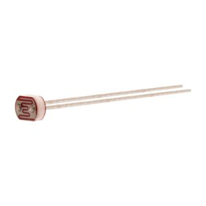{ width="120" }<br>**Option 1.**<br>**CdS photoresistor (LDR)**<br>Manufacturer: Advanced Photonix<br>Part #: PDV-P8103<br>$0.72/each<br>[DigiKey product page](https://www.digikey.com/en/products/detail/advanced-photonix/PDV-P8103/480610)<br>[PDV-P8103 datasheet](https://media.digikey.com/pdf/data%20sheets/photonic%20detetectors%20inc%20pdfs/pdv-p8103.pdf) | - Big resistance change: 16k to 33k ohm at 10 lux and over 0.5M ohm dark<br>- Sees visible light (400 to 700 nm), the same light as the room lamps<br>- Two leads, easy to mount under a window | - Slow, about 60ms rise time<br>- Part-to-part spread, so it needs calibration<br>- Room light changes the reading |
| 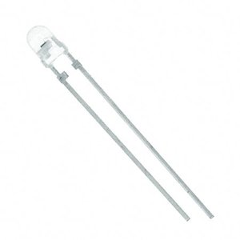{ width="120" }<br>Option 2.<br>Visible-light phototransistor<br>Manufacturer: Vishay<br>Part #: TEPT4400<br>$0.50/each<br>[DigiKey product page](https://www.digikey.com/en/products/detail/vishay-semiconductor-opto-division/TEPT4400/1681191)<br>[TEPT4400 datasheet](https://www.vishay.com/docs/81341/tept4400.pdf) | - Most inexpensive sensor here<br>- Responds like the human eye (peak at 570 nm)<br>- Much faster than a CdS cell | - Light current varies a lot between parts (15 to 70uA in the same test)<br>- Can saturate in bright light<br>- Narrow +/-30 degree view, so it has to be aimed |
| 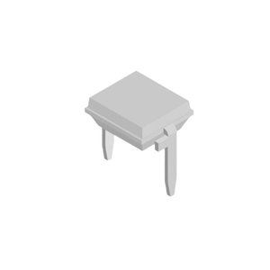{ width="120" }<br>Option 3.<br>PIN photodiode<br>Manufacturer: Vishay<br>Part #: BPW34<br>$1.37/each<br>[DigiKey product page](https://www.digikey.com/en/products/detail/vishay-semiconductor-opto-division/BPW34/1681149)<br>[BPW34 datasheet](https://www.vishay.com/docs/81521/bpw34.pdf) | - Current is very linear with light<br>- Large 7.5 mm^2 sensing area<br>- Low dark current (2nA typical) | - Needs a transimpedance amplifier, which means more parts<br>- Also sees infrared (430 to 1100 nm), so sunlight changes it<br>- Tiny currents need a very clean PCB |

**Choice:** Option 1: Advanced Photonix PDV-P8103, with my custom conditioning circuit

**Rationale:** The LDR gives a big, slow voltage change that matches how a cup is placed. I already used this sensor in my photoresistor lab. The photodiode is a good sensor, but it needs a different front end. The phototransistor has a wide part spread and can saturate. The LDR is not usable by itself for this class, so I buffer it and amplify it with an op amp (see [Cup Sensor Conditioning](#cup-sensor-conditioning-custom)).

## 5. Signal Conditioning Op Amp

I need two op amps on one 5V supply. U3A buffers the LDR divider. U3B is an inverting gain stage with a gain of -3 around a reference voltage from the PIC's DAC. I did not use an LM358 because its output cannot get close to the 5V rail.

| Solution | Pros | Cons |
|---|---|---|
| 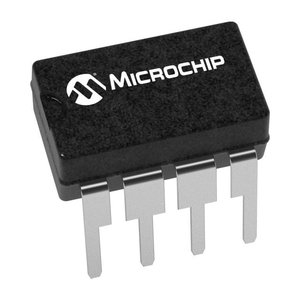{ width="120" }<br>**Option 1.**<br>**Dual rail-to-rail op amp, 8-pin DIP**<br>Manufacturer: Microchip Technology<br>Part #: MCP6002-I/P<br>$0.45/each<br>[DigiKey product page](https://www.digikey.com/en/products/detail/microchip-technology/MCP6002-I-P/500875)<br>[MCP6001/2/4 datasheet](https://ww1.microchip.com/downloads/en/DeviceDoc/MCP6001-1R-1U-2-4-1-MHz-Low-Power-Op-Amp-DS20001733L.pdf) | - Rail-to-rail input and output on a 1.8 to 6.0V supply<br>- Two op amps in one DIP (buffer and gain stage)<br>- Low current, 170uA max per amplifier | - Offset can be up to +/-4.5mV<br>- Only 1MHz bandwidth<br>- Output stops about 25mV from each rail |
| 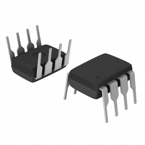{ width="120" }<br>Option 2.<br>Dual rail-to-rail op amp, 8-pin DIP<br>Manufacturer: Texas Instruments<br>Part #: TLV2372IP<br>$2.38/each<br>[DigiKey product page](https://www.digikey.com/en/products/detail/texas-instruments/TLV2372IP/413506)<br>[TLV237x datasheet](https://www.ti.com/lit/ds/symlink/tlv2372.pdf) | - Rail-to-rail input and output<br>- Wide 2.7 to 16V supply range<br>- 3MHz bandwidth | - About 5 times the price of the MCP6002<br>- Uses 550uA per channel<br>- Extra speed does not help a slow light sensor |
| 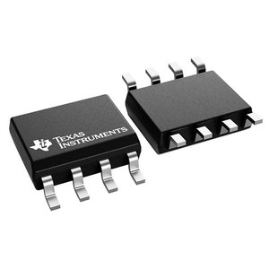{ width="120" }<br>Option 3.<br>Dual rail-to-rail op amp, SOIC-8<br>Manufacturer: Texas Instruments<br>Part #: OPA2340UA/2K5<br>$4.63/each<br>[DigiKey product page](https://www.digikey.com/en/products/detail/texas-instruments/OPA2340UA-2K5/301193)<br>[OPA2340 datasheet](https://www.ti.com/lit/ds/symlink/opa2340.pdf) | - Low offset, 500uV max<br>- 5.5MHz bandwidth<br>- Rail-to-rail input and output on 2.7 to 5.5V | - Most expensive op amp here<br>- SOIC surface mount takes more care to solder than DIP<br>- Up to 950uA per channel |

**Choice:** Option 1: Microchip MCP6002-I/P

**Rationale:** A cup sensor is slow, so 1MHz is more than enough. The DIP package is easy to breadboard and solder. The offset does not matter much because the firmware re-zeros the circuit with the DAC every time there is no cup. The other two cost a lot more and do not make cup detection any better.

## 6. Display

All three are plain display parts. The LED options need a driver IC on my PCB. The LCD connects through its own 16-pin parallel interface, with no I2C backpack.

| Solution | Pros | Cons |
|---|---|---|
| { width="120" }<br>Option 1.<br>4-digit yellow 7-segment display, 0.56 in<br>Manufacturer: Lucky Light (sold by Adafruit)<br>Part #: KW4-56NCUYA-P (Adafruit 811)<br>$3.95/each<br>[DigiKey product page](https://www.digikey.com/en/products/detail/adafruit-industries-llc/811/5774235)<br>[KW4-56NXUYA-P datasheet](https://cdn-shop.adafruit.com/datasheets/811datasheet.pdf) | - Big 0.56 in digits, easy to read from far away<br>- Bright LEDs work in any room light<br>- Inexpensive | - Cannot spell Ready, Filling, or Finished, so it fails requirement 2.1<br>- Cannot show the units next to the amount<br>- Needs a separate multiplexing driver IC |
| 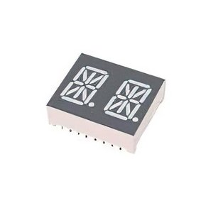{ width="120" }<br>Option 2.<br>2-character red 14-segment display, 0.53 in<br>Manufacturer: Kingbright<br>Part #: PDC54-11SURKWA<br>$5.60/each (I would need 4 of them, 22.40 USD total)<br>[DigiKey product page](https://www.digikey.com/en/products/detail/kingbright/PDC54-11SURKWA/16602198)<br>[PDC54-11SURKWA datasheet](https://www.kingbrightusa.com/images/catalog/SPEC/PDC54-11SURKWA.pdf) | - Can spell letters, 8 characters with 4 parts<br>- Bright, high-contrast LEDs<br>- 0.53 in characters | - Four parts in a row are 100.8 mm wide, more than my 100 mm board<br>- Still needs a driver IC and a lot of pins<br>- 8 characters cannot show the amount, units, and status at the same time |
| 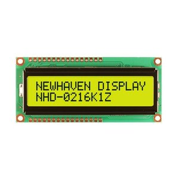{ width="120" }<br>**Option 3.**<br>**16x2 character LCD, parallel**<br>Manufacturer: Newhaven Display<br>Part #: NHD-0216K1Z-FL-YBW<br>$7.83/each<br>[DigiKey product page](https://www.digikey.com/en/products/detail/newhaven-display-intl/NHD-0216K1Z-FL-YBW/1701171)<br>[NHD-0216K1Z-FL-YBW datasheet](https://newhavendisplay.com/content/specs/NHD-0216K1Z-FL-YBW.pdf) | - Shows the amount and units on row 1 and the status on row 2 at the same time<br>- Built-in ST7066U controller, so no driver IC<br>- Transflective with a backlight, readable in room light | - Backlight can draw up to 156mA, my biggest load<br>- Contrast ratio is about 3 and is best from below (6 o'clock view)<br>- Needs a contrast trimmer and 6 PIC pins |

**Choice:** Option 3: Newhaven Display NHD-0216K1Z-FL-YBW

**Rationale:** This is the only option that meets requirement 2.1. It can show a number with its units and a full status word at the same time. The LED displays have bigger characters, but the 7-segment display cannot spell words, and 8 letters would force the screen to flip back and forth. I will mount the LCD so the user looks at it from slightly below, which is its best viewing direction, and set the contrast trimmer for the normal standing position (requirements 3.3 and 4.2). The module is 80 x 36 x 13.2 mm and the characters are 5.55 mm tall.

Example screens:

```
Target:   250 mL          Filling   123 mL          Finished  250 mL
Ready                     STOP to cancel            Remove cup
```

The LCD's controller is part of the display, not a separate backpack or breakout board. The backlight goes straight to the 5V rail through the LCD's built-in resistor, not through a PIC pin. A high display resolution does not prove +/-1% accuracy.

## 7. Display Interface

My earlier block diagram used a Holtek HT16K33 driver with a 7-segment display. I dropped it because a 7-segment display cannot show the status words, and Holtek has discontinued the HT16K33 ([EOL notice](https://www.holtek.com/webapi/168740/EOL_HT16K33.pdf)). All four options below can run the LCD I picked.

| Solution | Pros | Cons |
|---|---|---|
| 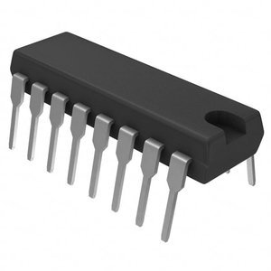{ width="120" }<br>Option 1.<br>I2C 8-bit I/O expander, 16-pin DIP<br>Manufacturer: Texas Instruments<br>Part #: PCF8574N<br>$2.98/each<br>[DigiKey product page](https://www.digikey.com/en/products/detail/texas-instruments/PCF8574N/484957)<br>[PCF8574 datasheet](https://www.ti.com/lit/ds/symlink/pcf8574.pdf) | - Only uses the two I2C pins I already have<br>- DIP package, easy to solder<br>- Very common for character LCDs | - 100kHz max, so it limits the whole team bus<br>- Its pins power up high, so E starts high<br>- Adds an IC, an I2C address, and LCD traffic on the team bus |
| 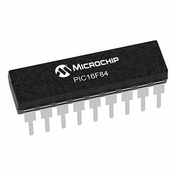{ width="120" }<br>Option 2.<br>I2C 8-bit I/O expander, 18-pin DIP<br>Manufacturer: Microchip Technology<br>Part #: MCP23008-E/P<br>$1.54/each<br>[DigiKey product page](https://www.digikey.com/en/products/detail/microchip-technology/MCP23008-E-P/735951)<br>[MCP23008 datasheet](https://ww1.microchip.com/downloads/en/DeviceDoc/MCP23008-MCP23S08-Data-Sheet-20001919F.pdf) | - Only uses the two I2C pins<br>- Push-pull outputs and I2C up to 1.7MHz<br>- Pins power up as inputs, so the E pull-down keeps E low | - Adds an IC and an I2C address<br>- Every LCD write shares the bus with pump and sensor messages<br>- More code: I2C writes plus the LCD timing |
| { width="120" }<br>Option 3.<br>8-bit shift register, 16-pin DIP<br>Manufacturer: Texas Instruments<br>Part #: SN74HC595N<br>$1.86/each<br>[DigiKey product page](https://www.digikey.com/en/products/detail/texas-instruments/SN74HC595N/277246)<br>[SN74HC595 datasheet](https://www.ti.com/lit/ds/symlink/sn74hc595.pdf) | - Uses 3 PIC pins instead of 6<br>- Keeps LCD traffic off the team I2C bus<br>- Push-pull outputs | - Adds an IC and more wiring<br>- Outputs are unknown at power-up unless I also control OE<br>- Still needs my own timing code |
| 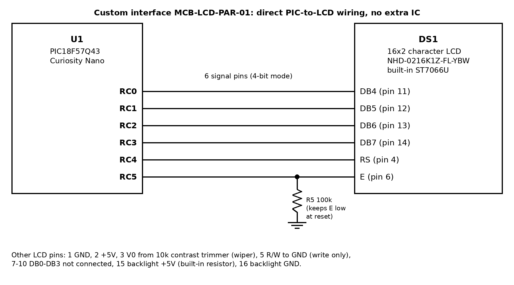{ width="200" }<br>**Option 4.**<br>**Custom direct PIC-to-LCD interface**<br>Designer: Nikita Bangiyev<br>Design ID: MCB-LCD-PAR-01<br>$0.00 extra (no added IC)<br>[Interface details](#custom-lcd-interface)<br>[LCD datasheet](https://newhavendisplay.com/content/specs/NHD-0216K1Z-FL-YBW.pdf) | - No extra IC and no extra I2C address<br>- LCD writes never use the team I2C bus<br>- Fewest parts, and easy to debug with a scope | - Uses 6 PIC pins<br>- I write the 4-bit setup and timing code myself<br>- More PCB traces between the Nano and the LCD |

**Choice:** Option 4: My custom direct interface to the LCD's built-in ST7066U controller

**Rationale:** I have six free pins on the Nano, so I do not need to save pins. Wiring the LCD straight to the PIC removes an IC and an I2C address, and it keeps display data off the team bus. That way STOP and the pump messages never wait behind LCD updates. The ST7066U inside the LCD already makes all the LCD drive signals, so I do not need any LED driver, shift register, or multiplexing transistors.

## Custom Circuits

### Cup Sensor Conditioning (Custom)

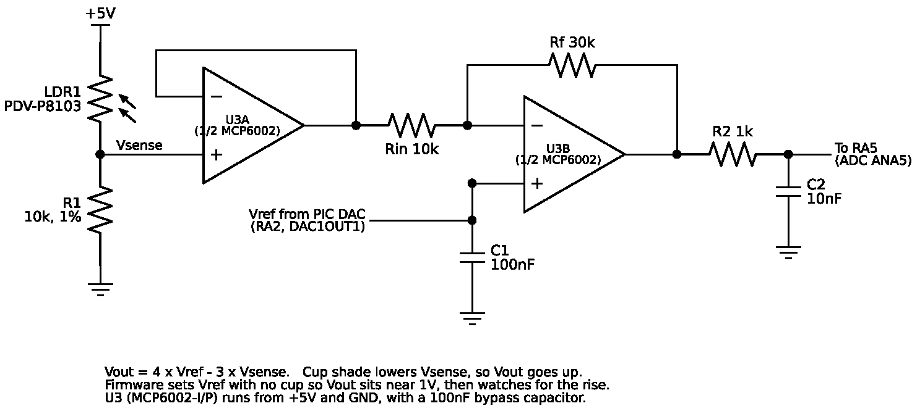{ width="100%" }

*Figure 1: Cup sensor conditioning circuit (click to enlarge).*

- The LDR goes from 5V to the sense node, and a 10k ohm, 1% resistor goes from the sense node to GND. Bright light gives a high Vsense. A cup's shadow lowers Vsense.
- U3A is a buffer so the gain stage does not load the divider.
- U3B has Rin = 10k ohm and Rf = 30k ohm, so the gain is -3. Its + input gets a reference voltage (Vref) from the PIC's DAC on RA2, with a 100nF capacitor to GND. The output is Vout = 4 x Vref - 3 x Vsense.
- The output goes to RA5 through 1k ohm, with 10nF to GND at the pin. This holds the voltage steady while the ADC samples.

**Why the DAC reference:** With a fixed 2.5V reference, the output only works for Vsense between about 1.7 and 3.3V. Outside that range it clips at a rail. In a bright room it could sit at 0V with or without a cup. Now the firmware sets Vref with no cup so the output sits near 1V. A cup shadow then pushes it up. The gain of 3 makes small changes 3 times bigger, which helps with lighter shadows like clear cups. This is why the amplifier matters and the buffer alone would not be enough. The DAC and the LDR divider both run from the same 5V, so a small change in the 5V rail cancels out.

**Calibration and detection plan (firmware, not tested yet):**

1. With no cup, step the DAC until the ADC reads about 1V. Save that as the baseline.
2. A cup is "present" when the reading stays at least 0.6V above the baseline for 200ms. It is "removed" when it drops back below 0.3V above the baseline. The gap between the two (hysteresis) stops flickering.
3. Average 16 ADC samples per reading to smooth out light flicker.
4. Re-zero slowly while idle with no cup, so it tracks changes in room light.
5. If the DAC hits its limit (room too dark or too bright) or a cup never gives enough change, show "Cup sensor" on the LCD and block START.

**Limits:** A clear cup with no liquid may only make a small shadow. If it is below the threshold, the display asks for a cup and START is blocked. That is safe, but it can be annoying. I still need to test real cups, room lights, and the 0.6V threshold on the prototype. The STOP button never waits for the sensor code.

### Custom LCD Interface

{ width="100%" }

*Figure 2: Custom interface MCB-LCD-PAR-01 (click to enlarge).*

- RC0-RC3 go to LCD DB4-DB7 (pins 11-14), RC4 goes to RS (pin 4), and RC5 goes to E (pin 6).
- R/W (pin 5) is tied to GND, so the LCD only listens and never drives the PIC pins. DB0-DB3 are left unconnected in 4-bit mode.
- Pin 1 is GND and pin 2 is 5V. Pin 3 (V0) comes from the wiper of a 10k ohm contrast trimmer between 5V and GND. Pins 15 and 16 are the backlight, to 5V and GND.
- A 100k ohm pull-down on E keeps the LCD from reading junk while the PIC is resetting.
- The firmware will do the datasheet's 4-bit startup sequence, send each byte as two halves, and wait the listed time after each command, since it cannot read the busy flag.
- Display updates happen in small steps between button checks. A STOP press always comes first and sends the pump stop message right away. Clay's pump board should also stop on its own if it loses communication.

## Pin Assignments

These are PIC port names, not Nano header numbers. All of these pins come out on the Nano's edge connector. RC0 and RC1 are free because the Nano's 32kHz crystal footprint is not connected by default (Nano user guide, section 4.2.3). None of these pins are shared with the on-board debugger. The PIC runs on its internal oscillator.

| Pin | Use | Connects to |
|---|---|---|
| RA0 | Digital input, active low | SW1 UP, 10k ohm pull-up to 5V |
| RA1 | Digital input, active low | SW2 DOWN, 10k ohm pull-up |
| RA4 | Digital input, active low | SW3 START, 10k ohm pull-up |
| RA3 | Digital input, active low | SW4 STOP, 10k ohm pull-up |
| RA2 | Analog output, DAC1OUT1 | U3B + input (Vref), 100nF to GND |
| RA5 | Analog input, ADC channel ANA5 | U3B output through 1k ohm, 10nF to GND |
| RD0 | Digital output, active low | Dispensing LED through 2.2k ohm |
| RD1 | Digital output, active low | Done LED through 2.2k ohm |
| RD2 | Digital output, active low | Fault LED through 2.2k ohm |
| RB2 | I2C1 SDA (open drain) | J1-J3 pin 1, one 4.7k ohm pull-up to 5V |
| RB1 | I2C1 SCL (open drain) | J1-J3 pin 2, one 4.7k ohm pull-up to 5V |
| RC0 | Digital output | LCD DB4 (pin 11) |
| RC1 | Digital output | LCD DB5 (pin 12) |
| RC2 | Digital output | LCD DB6 (pin 13) |
| RC3 | Digital output | LCD DB7 (pin 14) |
| RC4 | Digital output | LCD RS (pin 4) |
| RC5 | Digital output | LCD E (pin 6), 100k ohm pull-down |
| VTG | Power input | +5V from U2 (LM1086) |
| VOFF | Power setting | Tied to GND so the Nano's own regulator is off |
| GND | Ground | Board ground and J1-J3 pin 8 |

START moved from RA2 (in my block diagram assignment) to RA4, because RA2 is the only usable DAC output pin. The other DAC output (RB7) is shared with the Nano's programmer.

**Ribbon connectors J1-J3:** J1 goes to Cole, J2 to Clay, and J3 to Troy. On every connector, pin 1 is SDA, pin 2 is SCL, pins 3-7 are not connected, and pin 8 is GND. This follows the class standard (pins 1-5 digital, 6-7 analog, 8 GND). The team block diagram still shows +5V on pin 4. My board leaves pin 4 unconnected because every board has its own regulator, and the team needs to fix pin 4 before the boards are plugged together. My 4.7k ohm pull-ups are the only I2C pull-ups on the bus.

## Parts Without Selection Tables

The assignment says not to make tables for buttons, LEDs, passives, wire, or fuses. These are on my board but are not major components: Omron B3F-1000 buttons, three status LEDs, resistors and capacitors, a 10k ohm contrast trimmer, the Same Sky PJ-102AH barrel jack, three Wurth Elektronik 61200821621 2x4 box headers, the SP900S insulating pad, and mounting hardware. Their small currents are still counted in my [Power Budget](../05-Power-Budget/Power-Budget.md).

The only ICs on my board are U2 (LM1086) and U3 (MCP6002), plus the assigned Nano. The LCD has its own built-in controller. There are no added transistor switches, communication ICs, or actuators on my board.

## References

1. [Component Selection assignment](https://embedded-systems-design.bitbucket.io/304/individual-assignments/component-selection/), EGR 304.
2. [EGR 304 Fall 2026 project description](https://embedded-systems-design.bitbucket.io/304/course-info/project-description/).
3. [Course sequence requirements](https://embedded-systems-design.bitbucket.io/3x4/course-sequence-requirements/).
4. [Team 201 product requirements](https://egr304-2026-f-201.github.io/04-Product-Requirements/).
5. [My block diagram](../01-Block-Diagram/Block-Diagram.md).
6. Microchip, [PIC18F57Q43 Curiosity Nano hardware user guide, DS40002186B](https://ww1.microchip.com/downloads/aemDocuments/documents/MCU08/ProductDocuments/UserGuides/PIC18F57Q43-Curiosity-Nano-HW-UserGuide-DS40002186B.pdf).
7. Microchip, [PIC18F27/47/57Q43 data sheet, DS40002147H](https://ww1.microchip.com/downloads/aemDocuments/documents/MCU08/ProductDocuments/DataSheets/PIC18F27-47-57Q43-Microcontroller-Data-Sheet-XLP-DS40002147.pdf) (DAC1OUT1 on RA2, 12-bit ADC).
8. Same Sky, [PJ-102AH barrel jack datasheet](https://www.sameskydevices.com/product/resource/pj-102ah.pdf).
9. Bergquist, [SP900S-0.009-00-54 TO-220 insulating pad, DigiKey product page](https://www.digikey.com/en/products/detail/bergquist/SP900S-0-009-00-54/307797).
10. Holtek, [HT16K33 end-of-life notice](https://www.holtek.com/webapi/168740/EOL_HT16K33.pdf).
11. Product pages and datasheets for every option are linked in the tables above.

## Image Credits

Product photos come from the DigiKey product page for each part and are supplier pictures. A few photos are shared or generic. Both Triad adapters use Triad's WSU series photo. Both TI regulators use TI's TO-220 package photo. PCF8574N and SN74HC595N use TI's 16-pin DIP photo. MCP23008-E/P uses Microchip's generic 18-pin DIP photo. The PDC54-11SURKWA photo is DigiKey's PDC54 series picture. I made Figures 1 and 2 myself. The full list is in [Image-Sources.csv](Image-Sources.csv).

A PDF copy of this page is here: [Component-Selection.pdf](Component-Selection.pdf).
