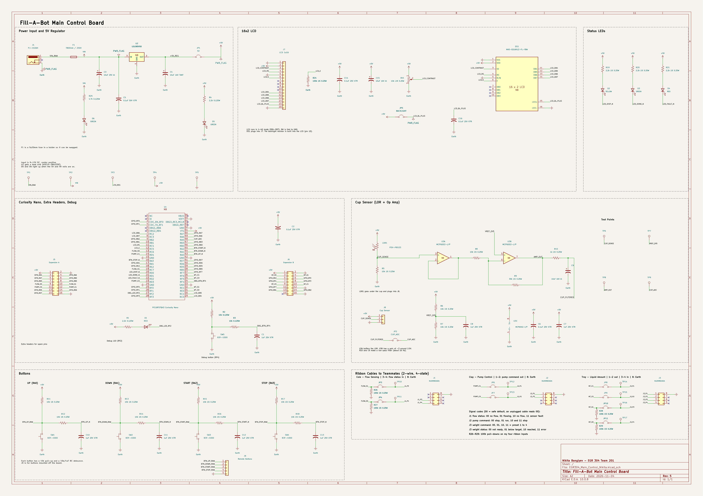

# Schematics

This is the schematic for my Main Control Board, Rev 7 (Nov 7, 2026). The PCB made from it is on my [PCB](../06-PCB/PCB.md) page.

{ width="100%" }

Figure 1: Main Control Board schematic, Rev 7

Files: [Schematic PDF](Nikita-Main-Control-Schematic.pdf), [Schematic image](Nikita-Main-Control-Schematic.png), [KiCad project ZIP](EGR304_Main_Control_Nikita_Rev7.zip)

## What's On It

### Power

The barrel jack (J4) takes 9-12V, center positive. It goes through a T800mA fuse in a holder (F1) so it can be swapped, and then the LD1085V50 regulator (U2) makes 5V. C3 and C5 are on the input and the 10uF tantalum C4 is on the output, which is what the ST datasheet asks for. U2's tab is at 5V, so it gets an insulator on its heat sink. JP1 is between the regulator and the 5V rail so I can cut power or measure current. D6 lights up when fused VIN is on and D5 when 5V is on.

### Nano

The Curiosity Nano gets 5V on VTG with VOFF tied to ground. C2 is its 0.1uF bypass cap.

### Buttons

UP (RA0) picks preset 1, DOWN (RA1) picks preset 2, START (RA2) starts the fill, and STOP (RA3) cancels at any time. Each button has a 10k pull-up and a 10k/1uF RC debounce.

### Cup sensor

The photoresistor sits under the cup spot and plugs into J8. U3A buffers it, U3B has a gain of -3 around a 2.5V reference from R6 and R7, and R10 and C9 make a low-pass filter (about 16 Hz) before the ADC on RA5. C6 is the op amp's bypass cap. JP2 can disconnect the ADC pin, and TP7, TP8, and TP9 are test points on the reference, the op amp output, and the ADC input.

### Status LEDs

Dispensing (yellow, RD0), Done (green, RD1), and Fault (red, RD2). They're active low. There's no screen on the board anymore, so these LEDs are how the user sees what's going on.

### Ribbons

J1, J2, and J3 go to Cole, Clay, and Troy. My four outputs go through 1N5817 diodes (D7-D10) with 10k pull-downs on the cable side (R30-R33), so a teammate's board can't push current back into my PIC. My four inputs have 100k pull-downs (R26-R29), so an unplugged cable reads 00 and the pump won't run. To cut off a teammate's board, I just unplug the cable.

### Debug and spare pins

D1 is the debug LED (RF2) and SW5 is the debug button (RF4). TP2-TP5 are on the power rails. J5 has +5V, GND, and 8 spare pins, and the other 14 spare pins go to test pads (TP18-TP31).

ERC shows 0 errors and 0 warnings, and every part I have to buy has its manufacturer part number in the KiCad file.

## Requirements

The numbers are from our team's [Product Requirements](https://egr304-2026-f-201.github.io/04-Product-Requirements/) page.

| Requirement | How my board does it |
|---|---|
| 6.7 Power | 9-12V in, fuse, 5V regulator with input and output caps |
| 2.1, 3.1 Pick the amount | UP for preset 1, DOWN for preset 2, then START |
| 6.1, Design 3.4 Stop any time | STOP button, pump command goes to 00 from any step |
| 3.3, 3.4 Status | Dispensing, Done, and Fault LEDs |
| 1.2, 2.2, 2.3, 6.4 Stop at the target | Sends the preset to Troy, stops the pump when Troy says the target is reached |
| 2.6 No unintended dispensing | Outputs start low (pump stopped), pull-downs on every ribbon line |
| 2.4 Repeat fills | Goes back to picking a preset after each fill |

## Ribbon Cables

| Header | Teammate | Pin 1 | Pin 2 | Pin 3 | Pin 4 | Pins 5-7 | Pin 8 |
|---|---|---|---|---|---|---|---|
| J1 | Cole (flow) | NC | NC | Flow S1 in (RC7) | Flow S0 in (RC6) | NC | GND |
| J2 | Clay (pump) | Pump C1 out (RD4) | Pump C0 out (RD3) | NC | NC | NC | GND |
| J3 | Troy (weight) | Preset C1 out (RF6) | Preset C0 out (RF5) | Weight S1 in (RE1) | Weight S0 in (RE0) | NC | GND |

J1-J3 are Wurth 61200821621 2x4 box headers, drawn with the counter-clockwise symbol the team agreed on. The signal codes are on my [Block Diagram](../01-Block-Diagram/Block-Diagram.md) page.

## Changes

| Rev | Date | What changed |
|---|---|---|
| 7 | Nov 7 | Took off the 16x2 LCD and its parts (J7, RV1, JP5, R24), plus C7, C14, C15, and C16. Took off J6, J9, the ribbon jumpers (JP3, JP4, JP6-JP11), and TP1, TP6, and TP10-TP17. Added the diodes D7-D10 and pull-downs R30-R33 on the ribbon outputs. J5 is now 2x5, and the spare pins go to test pads TP18-TP31. |
| 6 | Nov 6 | No wiring changes. Moved the footprints into my NB library and added the Nano socket and heat sink footprints. |
| 5 | Nov 4 | U2 changed to the LD1085V50 because the LM1086 was backordered. New ribbon connector symbol and C4 part number. No wiring changes. |
| 4 | Oct 30 | Cleaned up after the design review. Power arrows instead of long wires, pull-downs moved next to the ribbon headers, spare pin nets renamed. |
