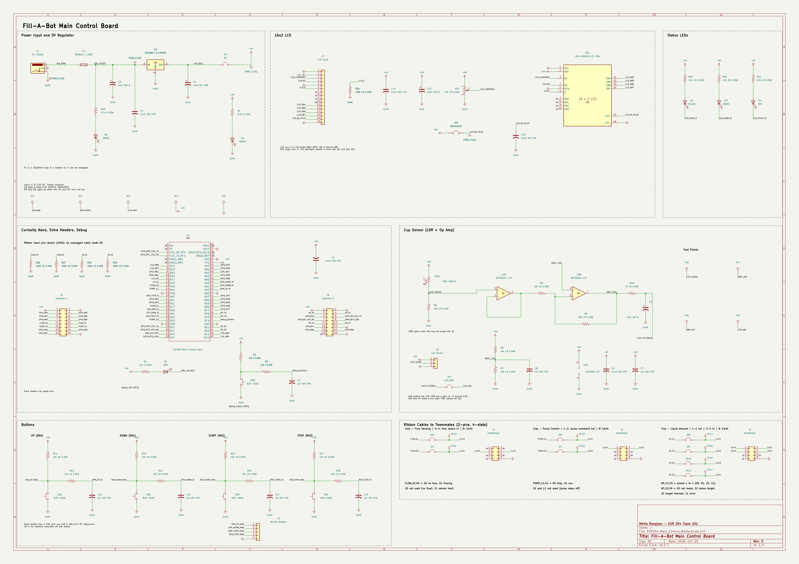

# Schematics

This is the schematic for my Main Control Board (rev 3, October 25, 2026). It has the 9-12V power input and 5V regulator, the Curiosity Nano, the cup sensor with the op amp, the LCD, the buttons and LEDs, and the three ribbon cables to my teammates' boards. Each signal on the ribbons is 2 plain digital wires with 4 states (00, 01, 10, 11). There's no UART, I2C, or SPI between boards.

{ width="100%" }

Figure 1: Main Control Board schematic (click to enlarge)

## How It Meets the Requirements

- **Power:** The barrel jack takes 9-12V, goes through a swappable T800mA fuse, and the LM1086 linear regulator makes 5V. It has the input and output caps from the TI datasheet (10uF tantalum on the output) and a 0.1uF bypass cap at every IC power pin. D6 and D5 show that the 9V and 5V rails are on.
- **User input:** UP and DOWN pick one of the 4 fill presets, START starts the fill, and STOP cancels it at any time. Each button has a 10k pull-up and an RC debounce. J9 lets the buttons be mounted off the board.
- **Cup sensor:** The photoresistor goes through a buffer, a gain stage, and a low-pass filter into the ADC (RA5). This is how the board knows a cup is there before it starts the pump.
- **Display and status:** The 16x2 LCD shows the preset amount and status (Ready, Filling, Finished, Error), and three LEDs show Dispensing, Done, and Fault. The Fault LED flashes when there's no flow.
- **Team:** J1, J2, and J3 follow the class ribbon standard with pin 8 as ground and no power pin. Pins 1-2 are always my outputs and pins 3-4 are always the teammate's outputs back to me. My board sends the pump command to Clay (RD4, RD3) and the preset to Troy (RF6, RF5), and reads the weight status from Troy (RE1, RE0) and the flow status from Cole (RC7, RC6).
- **Safe defaults:** The ribbon outputs start low, so the pump command is 00 (stop) at power-up. R26-R29 are 100k pull-downs on my four ribbon inputs, so an unplugged cable reads 00 (no flow or not ready) instead of floating.
- **Debugging:** There's a debug LED (RF2), a debug button (RF4), jumpers to cut the power and every ribbon signal, 17 test points (including one on every ribbon signal), and spare Nano pins on the J5 and J6 headers.
- **ERC:** 0 errors and 0 warnings (the report is in the KiCad ZIP).

## Ribbon Cables

| Header | Teammate | Pin 1 | Pin 2 | Pin 3 | Pin 4 | Pins 5-7 | Pin 8 |
|---|---|---|---|---|---|---|---|
| J1 | Cole (flow) | NC | NC | Flow S1 in (RC7) | Flow S0 in (RC6) | NC | GND |
| J2 | Clay (pump) | Pump C1 out (RD4) | Pump C0 out (RD3) | NC | NC | NC | GND |
| J3 | Troy (weight) | Weight C1 out (RF6) | Weight C0 out (RF5) | Weight S1 in (RE1) | Weight S0 in (RE0) | NC | GND |

Each ribbon signal goes through a jumper (JP3, JP4, JP6-JP11) and has a test point, so I can unplug one line or check it with a meter.

## Signal Codes

| Signal | 00 | 01 | 10 | 11 |
|---|---|---|---|---|
| Pump command (to Clay) | Stop | Run | Not used (stop) | Not used (stop) |
| Weight command (to Troy) | Preset 1 | Preset 2 | Preset 3 | Preset 4 |
| Weight status (from Troy) | Not ready | Below target | Target reached | Error |
| Flow status (from Cole) | No flow | Flowing | Not used (no flow) | Sensor fault |

## Changes in Rev 3

- Took out the UART lines on J1-J3 and wired the 2-wire, 4-state signals above.
- Added R26-R29 (100k pull-downs) on the four ribbon inputs.
- Added JP10, JP11, TP16, and TP17 for Troy's two status lines.

## Files

- [Schematic PDF](Nikita-Main-Control-Schematic.pdf)
- [KiCad project ZIP](EGR304_Main_Control_Nikita.zip)
