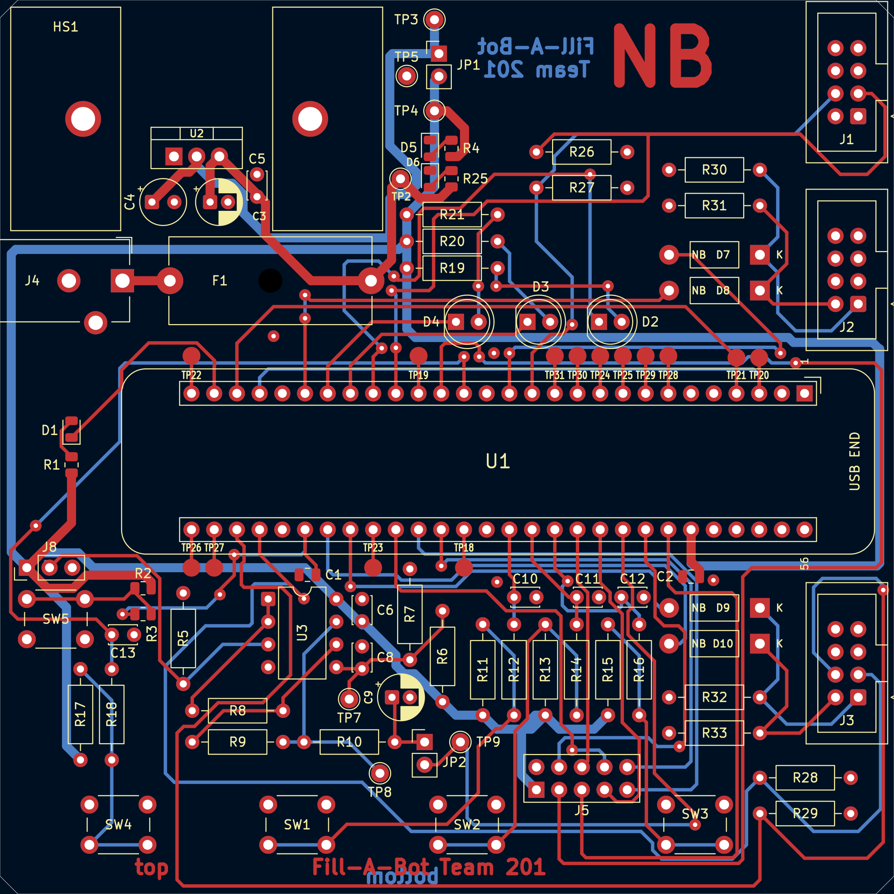
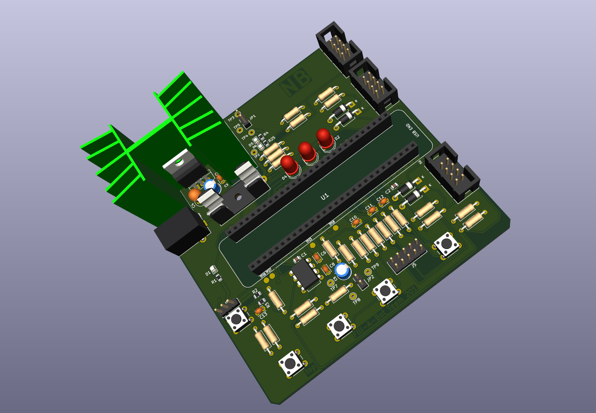
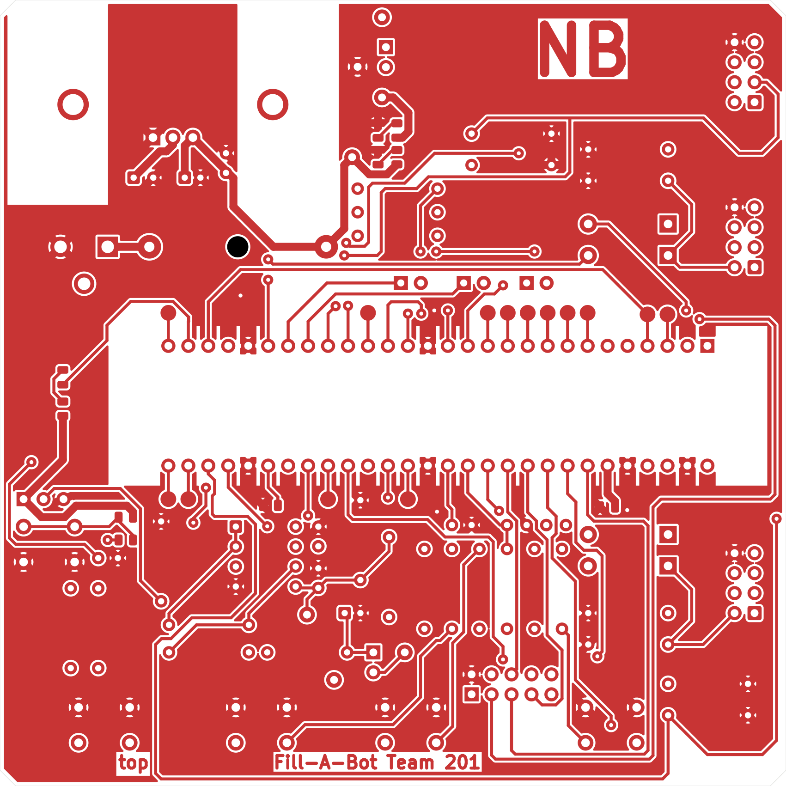
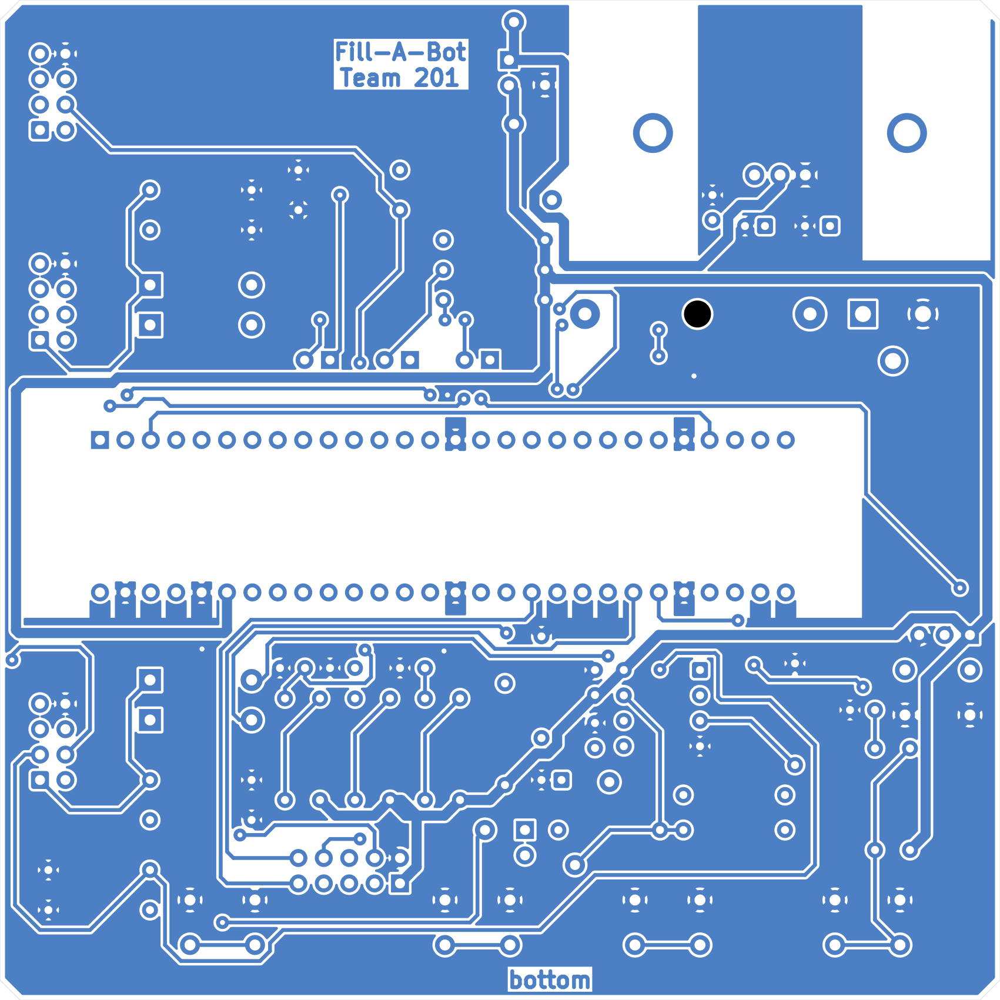
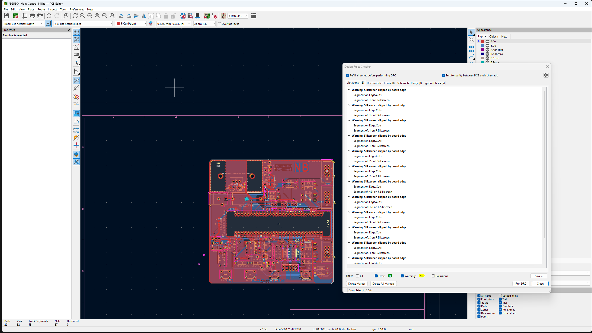

# PCB

This is the PCB for my Main Control Board (Rev 7, Nov 9, 2026). It's a 2-layer board, 100 x 100 mm with chamfered corners, made in KiCad 10 from my [Rev 7 schematic](../04-Schematic/schematic.md).

{ width="100%" }

Figure 1: PCB layout. Top traces are red, bottom traces are blue. The ground pours are hidden here so the traces are easier to see.

{ width="100%" }

Figure 2: 3D view from KiCad

{ width="49%" } { width="49%" }

Figure 3: Top copper (left) and bottom copper (right) with the ground pours. The bottom is shown from underneath, so it's mirrored.

## Files

- [KiCad project ZIP (Rev 7)](EGR304_Main_Control_Nikita_Rev7.zip): schematic, PCB, my NB footprint library, symbols, and 3D models
- [Gerber files ZIP](NikitaBangiyev201.zip): top and bottom copper, solder mask, and silkscreen, the board outline, and the drill files
- [1:1 print (PDF)](PCB_1to1_Print.pdf): top and bottom copper at actual size, for checking that the parts fit
- [DRC screenshot](DRC_Confirmation.png)

## Design Rules

| Rule | Class rule | My board |
|---|---|---|
| Layers | 2 | 2 |
| Size | 100 x 100 mm max | 100 x 100 mm, 2 mm chamfers |
| Copper | 0.5 oz | 0.5 oz |
| Clearance | 10 mil (0.254 mm) | 0.254 mm |
| Signal traces | 15 mil (0.381 mm) min | 0.381 mm |
| Power traces | 40 mil (1.016 mm) min | 1.016 mm |
| Annular ring | 15 mil (0.381 mm) min | 0.381 mm min |
| Vias | 19.7 mil (0.5 mm) drill | 32 vias, 1.3 mm pad, 0.5 mm drill |
| Copper to hole | 10 mil (0.254 mm) | 0.254 mm |
| Hole to hole | 31.5 mil (0.8 mm) | 0.8 mm (closest pair is 1.06 mm) |
| Solder mask clearance | 5 mil (0.127 mm) | 0.127 mm |

I checked the power trace width with the IPC-2221 formula. A 40 mil trace in 0.5 oz copper can carry about 1.5A with a 10 C rise, and my fuse is only 800mA, so the power traces have lots of room. The 15 mil signal traces only carry a few mA.

## Layout

The power parts are in the top left corner. The barrel jack is on the left edge, the fuse is right next to it, and the regulator sits on its heat sink. Nothing is routed between the heat sink fins.

The Curiosity Nano plugs into a socket in the middle. Only the socket pads and their escape traces are under it. The three ribbon headers are on the top side along the right edge, so the cables all leave on one side and stay away from the buttons.

The buttons are in a row along the bottom edge where they're easy to reach (STOP, UP, DOWN, START from left to right). The status LEDs are in a row above the Nano. The cup sensor header (J8) is on the left edge, and the op amp and filter are below the Nano. J5 and the spare-pin test pads are right next to the Nano pins they connect to.

The bypass caps are close to their chips: C2 is 5.3 mm from the Nano's VTG pin, C6 is 3.8 mm from the op amp's power pin, and the regulator caps are 5 to 7 mm from U2.

## Ground and Routing

There are no ground traces. Ground is a copper pour on both sides with thermal reliefs and no islands, and all 49 ground pads connect through the pours. I didn't use the autorouter. Every bend is 45 degrees, and there are 32 vias. There's one T-junction left on FLOW_S1 near R26, because there's no room to move it without rerouting another signal.

"NB" is on the top copper in a big bold font (6 mm tall). "top" and "Fill-A-Bot Team 201" are on the top copper, and "bottom" and "Fill-A-Bot Team 201" are on the bottom copper, mirrored so they read right from underneath. My custom footprints have NB in them and are in my NB footprint library, which is in the KiCad ZIP.

## DRC

I ran DRC with "Refill all zones" and "Test for parity" turned on. It shows 0 errors, 0 unconnected items, and 0 parity problems. The 13 warnings are all silkscreen. The J1-J4 and HS1 outlines run to the board edge because those parts sit at the edge, and one LED outline is close to a test pad.

{ width="100%" }

Figure 4: DRC results with the board in the same screenshot

## Changes After the First Layout

- Fixed sharp corners and T-junctions on BTN_START_N, +5V, VREF_2V5, and WT_S0, and closed a tiny gap on GPIO_RB0.
- Made the NB on the top copper big and bold.
- Added 3D models for the diodes (D7-D10) and J5.
- Ran the Gerbers through the JLCPCB DFM check and cleaned up the silkscreen, so the labels sit inside their parts where they fit and none are on a pad or a via.
- Set the solder mask clearance to 5 mil to match the class rules. That only changes the solder mask files.
